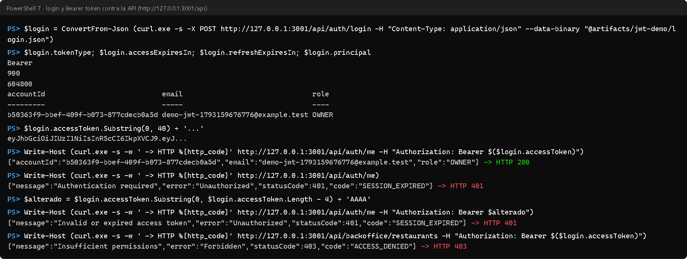
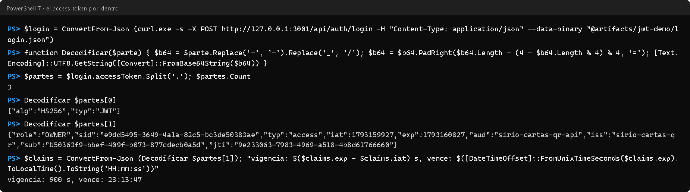
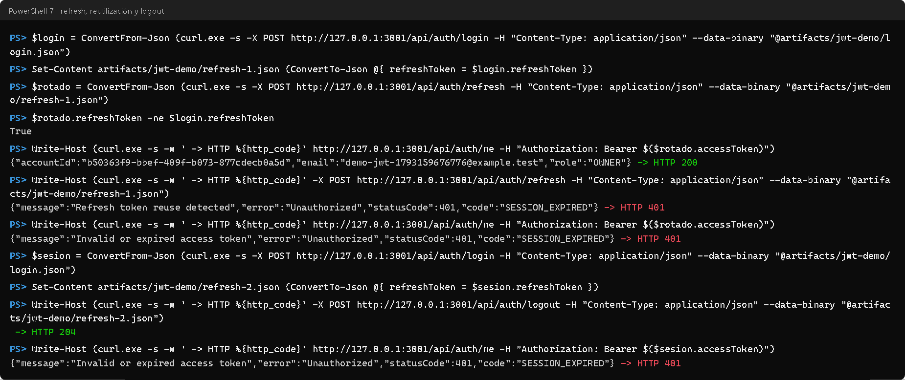
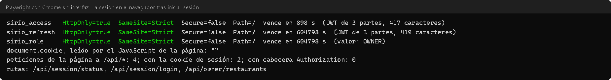
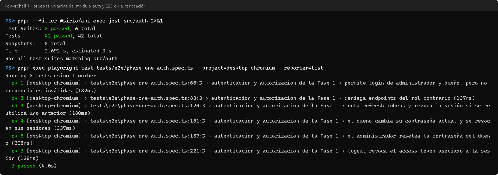

# Informe: autenticación con JWT en el Sistema de Cartas QR

Este informe presenta el avance de autenticación del proyecto final: el servicio de login emite tokens JWT y la API exige un *bearer token* en todas sus rutas protegidas. Explica cómo funciona y dónde está en el código, y muestra la evidencia de que funciona. La evidencia salió del sistema real, levantado con Docker Compose el 27 de octubre de 2026, con una cuenta de dueño creada solo para la demostración.

## 1. Resumen

- **Servicio de login.** `POST /api/auth/login` recibe correo, contraseña y rol, y responde con un *access token* (15 minutos) y un *refresh token* (7 días), ambos JWT firmados con HS256.
- **Bearer token.** Toda ruta de la API exige `Authorization: Bearer <access token>`, salvo las marcadas como públicas:
  - sin token, o con uno alterado o vencido, la respuesta es `401`;
  - con un rol que no corresponde, `403`.
- **Sesiones revocables.** Cada token lleva el identificador de su sesión y la API comprueba en PostgreSQL que siga activa. Así, cerrar sesión, cambiar la contraseña o reutilizar un *refresh token* viejo deja inservibles los tokens al instante, sin esperar a que venzan.
- **Navegador.** Nunca ve el token: el servidor web lo guarda en cookies `HttpOnly` y llama a la API con el *bearer token* en su nombre.

## 2. Cómo funciona un JWT

Un JWT (RFC 7519) son tres partes en Base64URL separadas por puntos: `cabecera.contenido.firma`.

- **Cabecera.** Dice cómo se firmó; aquí, `{"alg":"HS256","typ":"JWT"}`.
- **Contenido (*claims*).** Lleva los datos: quién es (`sub`), su rol, cuándo se emitió (`iat`) y cuándo vence (`exp`), quién lo emitió (`iss`) y para quién (`aud`).
- **Firma.** Con HS256 es un HMAC-SHA256 de las dos primeras partes, calculado con un secreto que solo conoce el servidor. Cualquiera puede leer el contenido, pero nadie puede cambiarlo sin invalidar la firma.

Para usarlo, el cliente lo envía en cada petición con la cabecera `Authorization: Bearer <token>` (RFC 6750). El servidor verifica la firma y los claims, y así sabe quién llama sin consultar la contraseña otra vez.

Un JWT, en principio, no se puede revocar: vale hasta su `exp`. Este proyecto lo compensa con dos medidas:

- un *access token* corto (15 minutos);
- un identificador de sesión (`sid`) que la API comprueba en cada petición.

## 3. La autenticación en Sirio

### 3.1 Los servicios

| Servicio | Acceso | Qué hace |
|---|---|---|
| `POST /api/auth/login` | Público | Valida correo, contraseña y rol; abre una sesión y devuelve `tokenType: "Bearer"`, los dos tokens, sus duraciones y el usuario |
| `POST /api/auth/refresh` | Público, con el *refresh token* | Entrega un par de tokens nuevo y retira el anterior; reutilizar el viejo revoca la sesión |
| `POST /api/auth/logout` | Público, con el *refresh token* | Revoca la sesión (`204`) |
| `GET /api/auth/me` | Bearer | Devuelve quién es el dueño del token |
| `POST /api/auth/password` | Bearer, dueño | Cambia la contraseña propia y revoca todas las sesiones de la cuenta |
| `POST /api/auth/admin/owners/:id/reset-password` | Bearer, administrador | Restablece la contraseña de un dueño |

### 3.2 Qué lleva el token y cómo se verifica

`JwtTokenService` firma cada token con estos claims:

- `sub`: la cuenta;
- `role`: `OWNER` o `ADMIN`;
- `sid`: la sesión;
- `typ`: `access` o `refresh`;
- `jti`: un identificador único;
- `iss`, `aud` y `exp`.

El *access token* y el *refresh token* usan **secretos distintos**, de al menos 32 caracteres. La API valida ese largo al arrancar y no inicia si no se cumple.

Al verificar, la API fija el algoritmo (`HS256`, sin aceptar otro), el emisor y la audiencia, y comprueba que el tipo sea el esperado, de modo que un *refresh token* no sirve como *access token*. Después busca la sesión `sid` en la tabla `AuthSession`: si fue revocada o venció, el token se rechaza aunque su firma sea válida.

### 3.3 Guards: privado por defecto

`AccessTokenGuard` y `RolesGuard` están registrados como guards globales de NestJS, así que **toda ruta es privada salvo que se marque `@Public()`**:

1. `AccessTokenGuard` extrae el token de `Authorization: Bearer …`, lo verifica y deja el usuario en la petición. Sin token, o con uno inválido, responde `401`.
2. `RolesGuard` compara el rol del token con el que pide la ruta (`@Roles(AuthRole.ADMIN)`) y responde `403` si no coincide.
3. `OwnerRestaurantGuard` añade, en las rutas con `:restaurantId`, que el restaurante sea del dueño del token. Es la defensa contra el acceso a datos ajenos (IDOR).

### 3.4 Refresh, reutilización y cierre de sesión

- **Huella del refresh.** La base de datos no guarda el *refresh token*, sino su huella SHA-256.
- **Rotación.** Al renovar, la API cambia esa huella por la del token nuevo en una sola operación. Si alguien presenta el token anterior, la huella ya no coincide: la API lo interpreta como un robo («Refresh token reuse detected») y revoca la sesión entera.
- **Cierre.** `logout`, cambiar la contraseña o que un administrador la restablezca revocan las sesiones, y desde ese momento sus *access tokens* devuelven `401`.

### 3.5 Contraseñas

Las contraseñas se guardan con **Argon2id** (19 MiB de memoria, 2 iteraciones, paralelismo 1), la configuración mínima que recomienda OWASP.

Si el correo no existe, el login calcula igualmente un hash antes de responder «Invalid email or password». Así tarda lo mismo, y el tiempo de respuesta no revela qué correos están registrados.

### 3.6 El navegador

El panel web no llama a la API directamente. Pasa por el servidor de Next.js, que actúa de intermediario (BFF):

```text
navegador ── cookie HttpOnly ──→ Next.js (BFF) ── Authorization: Bearer ──→ API NestJS
```

- **Las cookies.** Tras el login, el BFF guarda los tokens en cookies `HttpOnly` y `SameSite=Strict`, y en producción también `Secure`. El JavaScript de la página no puede leerlas, así que un script inyectado tampoco podría robar el token.
- **Las peticiones.** En cada petición, el BFF toma la cookie y llama a la API con `Authorization: Bearer`. Si la API responde `401`, renueva con el *refresh token* y reintenta una vez.

### 3.7 Dónde está

| Pieza | Archivo |
|---|---|
| Servicios de autenticación | [`auth.controller.ts`](../backend/src/auth/auth.controller.ts#L41): login ([L41](../backend/src/auth/auth.controller.ts#L41)), refresh ([L52](../backend/src/auth/auth.controller.ts#L52)), logout ([L63](../backend/src/auth/auth.controller.ts#L63)) y `me` ([L73](../backend/src/auth/auth.controller.ts#L73)) |
| Firma y verificación | [`jwt-token.service.ts`](../backend/src/auth/infrastructure/jwt-token.service.ts#L68): `sign` ([L68](../backend/src/auth/infrastructure/jwt-token.service.ts#L68)) y `verify` ([L92](../backend/src/auth/infrastructure/jwt-token.service.ts#L92)) |
| Flujo de sesión | [`auth.service.ts`](../backend/src/auth/application/auth.service.ts#L51): login ([L51](../backend/src/auth/application/auth.service.ts#L51)), refresh con detección de reutilización ([L79](../backend/src/auth/application/auth.service.ts#L79)), logout ([L112](../backend/src/auth/application/auth.service.ts#L112)) y verificación del *access token* ([L121](../backend/src/auth/application/auth.service.ts#L121)) |
| Guards | [`access-token.guard.ts`](../backend/src/auth/presentation/access-token.guard.ts#L26), [`roles.guard.ts`](../backend/src/auth/presentation/roles.guard.ts#L20), [`owner-restaurant.guard.ts`](../backend/src/auth/presentation/owner-restaurant.guard.ts#L22), registrados como globales en [`auth.module.ts`](../backend/src/auth/auth.module.ts#L110) |
| Configuración | [`environment.ts`](../backend/src/config/environment.ts#L252): secretos de al menos 32 caracteres y duraciones `15m` y `7d` |
| Sesiones | Tabla `AuthSession` en [`schema.prisma`](../backend/prisma/schema.prisma#L120) |
| Navegador | [`api-server.ts`](../frontend/src/lib/api-server.ts#L54): cookies ([L54](../frontend/src/lib/api-server.ts#L54)) y llamada con Bearer ([L189](../frontend/src/lib/api-server.ts#L189)) |

## 4. Evidencia

Las figuras 1 a 4 son transcripciones de PowerShell 7 y de Playwright ejecutados contra la API y la web reales. Cada línea `PS>` es el comando tal como se ejecutó, y debajo aparece su salida sin editar.

- **Credenciales.** El cuerpo del login se lee de un archivo local que git ignora, así que ninguna contraseña aparece en pantalla.
- **El token.** Se muestra recortado: solo sus primeros 40 caracteres.

**Figura 1.** Login y bearer token:

- el login devuelve `tokenType` `Bearer` y duraciones de 900 s y 604 800 s;
- con el token, `GET /auth/me` responde `200` con el usuario;
- sin token, `401`;
- con la firma alterada, `401`;
- con un token de dueño en una ruta de administrador, `403`.



**Figura 2.** El *access token* por dentro. Tiene tres partes, la cabecera dice `HS256` y el contenido muestra `role`, `sid`, `typ`, `iss`, `aud`, `sub`, `jti` y una vigencia de 900 s:



**Figura 3.** Refresh, reutilización y logout:

- el refresh entrega un token distinto, y el *access token* nuevo funciona;
- reutilizar el *refresh token* anterior responde «Refresh token reuse detected», y la sesión queda revocada: el *access token* recién emitido también pasa a `401`;
- un logout (`204`) deja inservible el *access token* de esa sesión.



**Figura 4.** El navegador tras iniciar sesión en el formulario real:

- las tres cookies de sesión son `HttpOnly` y `SameSite=Strict`; `Secure` es `false` porque la prueba usa `http` en local, y en producción, con `https`, se activa;
- `document.cookie` está vacío para el JavaScript de la página;
- de las peticiones de la página, ninguna lleva la cabecera `Authorization`: el *bearer token* solo viaja entre el servidor web y la API.



**Figura 5.** Las pruebas automáticas de autenticación: las 42 unitarias del módulo `auth` y las 6 E2E contra el stack real, todas en verde:



## 5. Pruebas

| Prueba | Qué verifica |
|---|---|
| [`jwt-token.service.spec.ts`](../backend/src/auth/infrastructure/jwt-token.service.spec.ts) | Access y refresh firmados por separado; un tipo confundido, otro emisor u otro secreto se rechazan |
| [`auth.service.spec.ts`](../backend/src/auth/application/auth.service.spec.ts) | Login con sesión persistida; el mismo error, con hash incluido, para una cuenta inexistente; rotación atómica; reutilización que revoca; sesión comprobada en cada *access token*; cambio y restablecimiento de contraseña |
| [`authorization.guards.spec.ts`](../backend/src/auth/presentation/authorization.guards.spec.ts) | Rutas públicas, Bearer válido, token ausente o inválido, roles y pertenencia del restaurante |
| [`argon2-password.hasher.spec.ts`](../backend/src/auth/infrastructure/argon2-password.hasher.spec.ts) | Hash Argon2id, verificación y hash mal formado |
| [`phase-one-auth.spec.ts`](../tests/e2e/phase-one-auth.spec.ts) (E2E) | Contra la API real: login de ambos roles, endpoints del rol contrario, rotación y reutilización, cambio y restablecimiento de contraseña, y logout |

## 6. Limitaciones conocidas

- **Sin límite de intentos.** El login no limita los intentos fallidos. Las contraseñas con Argon2id hacen caro cada intento, pero un límite por correo e IP sería la siguiente mejora.
- **Sin documentación OpenAPI.** No hay Swagger con el botón «Authorize»; la API se documenta en el README.

## 7. Conclusión

La autenticación con JWT ya está integrada en todos los servicios del proyecto final:

- el servicio de login emite el par de tokens;
- todas las rutas exigen el *bearer token* salvo las públicas, y los roles se aplican con `@Roles`;
- la API rechaza un token alterado, vencido o de otra sesión.

Sobre el mínimo pedido, el diseño suma sesiones revocables, rotación del *refresh token* con detección de reutilización y cookies `HttpOnly` en el navegador. La evidencia muestra cada caso funcionando contra el sistema real, y las 48 pruebas lo verifican en cada cambio.

## 8. Fuentes

- IETF, [RFC 7519: JSON Web Token](https://www.rfc-editor.org/rfc/rfc7519) y [RFC 6750: Bearer Token Usage](https://www.rfc-editor.org/rfc/rfc6750).
- OWASP, [JSON Web Token for Java Cheat Sheet](https://cheatsheetseries.owasp.org/cheatsheets/JSON_Web_Token_for_Java_Cheat_Sheet.html) (sus recomendaciones no dependen del lenguaje) y [Password Storage Cheat Sheet](https://cheatsheetseries.owasp.org/cheatsheets/Password_Storage_Cheat_Sheet.html) (Argon2id).
- NestJS, [Authentication](https://docs.nestjs.com/security/authentication) y [Guards](https://docs.nestjs.com/guards).
- MDN, [Set-Cookie: HttpOnly, SameSite y Secure](https://developer.mozilla.org/en-US/docs/Web/HTTP/Reference/Headers/Set-Cookie).
