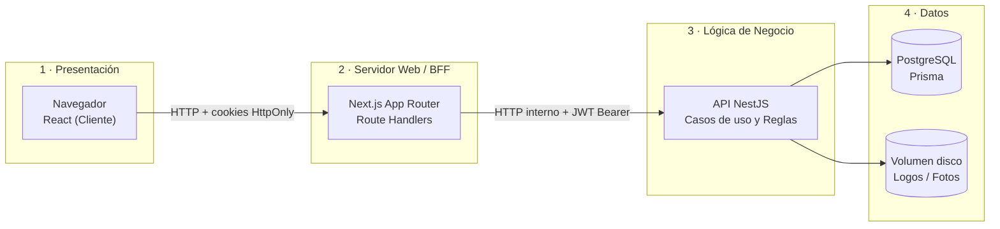
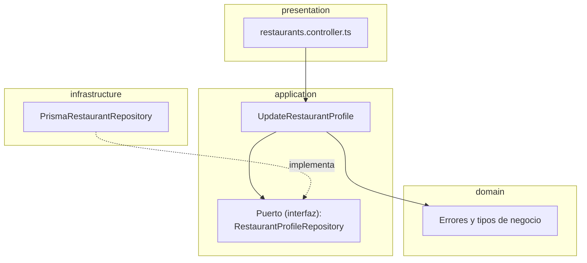
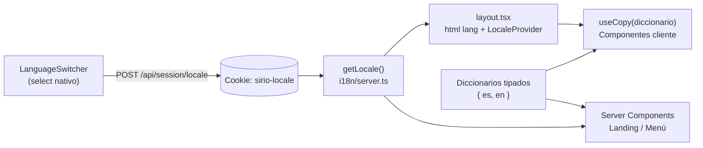
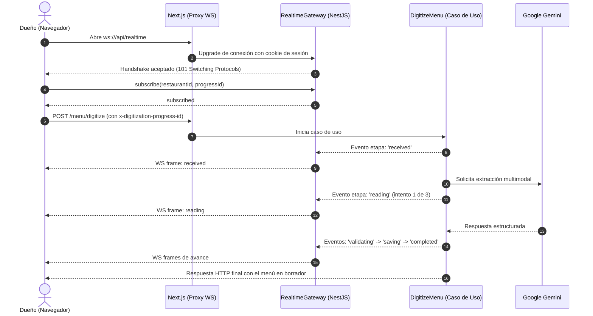
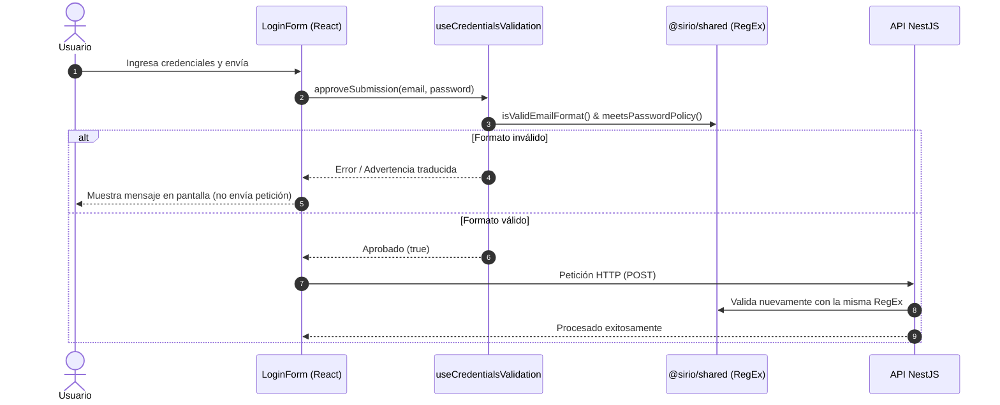
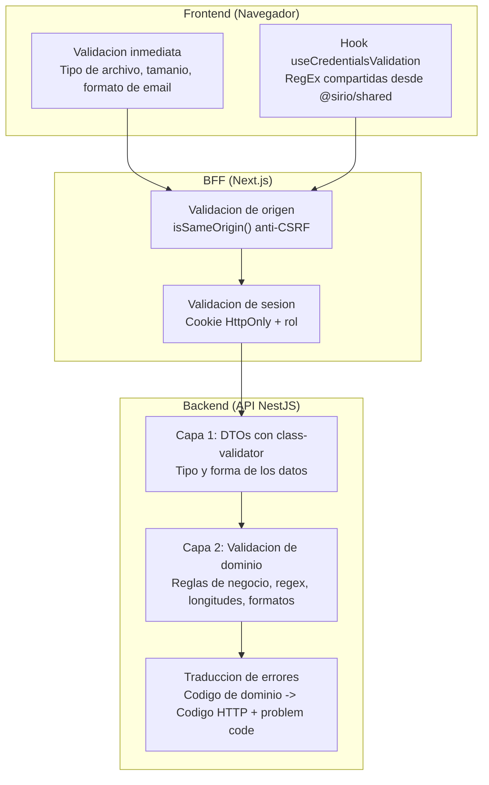

# Conceptos Clave y Arquitectura — Sistema de Cartas QR

Este documento explica de forma clara y didáctica los 5 pilares conceptuales del proyecto, acompañados de diagramas y de las **rutas exactas en el código fuente** donde se implementa cada uno.

---

## 1. Arquitectura en N-Capas

### Explicación
Una arquitectura en capas organiza el sistema en niveles jerárquicos donde cada capa tiene una **responsabilidad única** y solo se comunica con la capa inmediata siguiente. En este proyecto, la arquitectura se aplica en dos niveles:

1. **A nivel de Sistema Global (4 Capas):**
   - **Capa 1: Presentación (Frontend):** Navegador del usuario ejecutando componentes React 19. No conoce tokens ni base de datos.
   - **Capa 2: Servidor Web / BFF (*Backend for Frontend*):** Next.js 16 con Route Handlers. Protege las sesiones en cookies `HttpOnly`, valida el origen de la petición (`isSameOrigin` contra CSRF) y enruta de forma segura hacia la API.
   - **Capa 3: Lógica de Negocio (Backend Core):** API en NestJS 11. Aplica casos de uso, autenticación JWT, digitalización con IA y generación de códigos QR.
   - **Capa 4: Datos y Persistencia:** PostgreSQL (gestionado mediante Prisma ORM) y volumen en disco para imágenes y logos.



2. **A nivel interno de la API (Arquitectura Hexagonal / Puertos y Adaptadores):**
   Cada módulo de la API (`restaurants`, `menu-management`, `digitization`, `auth`, `analytics`) se subdivide en:
   - **`domain`:** Entidades y errores puros de negocio (cero dependencias de librerías externas).
   - **`application`:** Casos de uso (`use-cases`) y contratos/interfaces denominados **puertos** (`ports`).
   - **`infrastructure`:** Adaptadores técnicos que implementan los puertos (Prisma, almacenamiento en disco, etc.).
   - **`presentation`:** Controladores NestJS que reciben peticiones HTTP y llaman a los casos de uso.



### Ubicación en el código

| Elemento | Archivo | Líneas / Descripción |
|---|---|---|
| **Capa 1: Presentación (Vistas)** | [`apps/web/src/app`](file:///e:/Sistema_Cartas_QR/apps/web/src/app) | Páginas públicas (`/{slug}`), panel del dueño (`/admin`) y backoffice. |
| **Capa 2: BFF (Route Handler seguro)** | [`apps/web/src/app/api/owner/restaurants/[restaurantId]/profile/route.ts`](file:///e:/Sistema_Cartas_QR/apps/web/src/app/api/owner/restaurants/%5BrestaurantId%5D/profile/route.ts#L23-L45) | Valida `isSameOrigin`, inyecta token de la cookie y hace proxy a la API. |
| **Capa 2: Utilidades del BFF** | [`apps/web/src/lib/api-server.ts`](file:///e:/Sistema_Cartas_QR/apps/web/src/lib/api-server.ts) | `authenticatedApiFetch`, `isSameOrigin`, `proxyApiResponse`. |
| **Capa 3: API Presentation** | [`apps/api/src/restaurants/restaurants.controller.ts`](file:///e:/Sistema_Cartas_QR/apps/api/src/restaurants/restaurants.controller.ts#L130-L155) | Controlador HTTP que valida DTO y delega al caso de uso. |
| **Capa 3: API Application (Caso de uso)** | [`apps/api/src/restaurants/application/use-cases/update-restaurant-profile.ts`](file:///e:/Sistema_Cartas_QR/apps/api/src/restaurants/application/use-cases/update-restaurant-profile.ts#L22-L60) | Orquesta las reglas de negocio sin depender de frameworks. |
| **Capa 3: API Application (Puerto)** | [`apps/api/src/restaurants/application/ports/restaurant-profile.repository.ts`](file:///e:/Sistema_Cartas_QR/apps/api/src/restaurants/application/ports/restaurant-profile.repository.ts) | Interfaz TypeScript que define las operaciones de persistencia necesarias. |
| **Capa 3: API Domain** | [`apps/api/src/restaurants/domain/restaurant.types.ts`](file:///e:/Sistema_Cartas_QR/apps/api/src/restaurants/domain/restaurant.types.ts) | Modelos y tipos de datos puros. |
| **Capa 4: API Infrastructure (Adaptador)** | [`apps/api/src/restaurants/infrastructure/prisma-restaurant.repository.ts`](file:///e:/Sistema_Cartas_QR/apps/api/src/restaurants/infrastructure/prisma-restaurant.repository.ts#L37) | Implementa el puerto utilizando Prisma ORM. |
| **Capa 4: Esquema de Base de Datos** | [`prisma/schema.prisma`](file:///e:/Sistema_Cartas_QR/prisma/schema.prisma) | Definición de modelos en PostgreSQL. |

---

## 2. Funciones Stateful y Stateless

### Explicación
La diferencia radica en si la función/componente **guarda memoria del pasado** o si es puramente predictiva:

* **Stateful (Con estado):**  
  Guarda información interna que cambia durante la interacción del usuario (utilizando `useState` o `useReducer` en React). Si el estado cambia, el componente se vuelve a dibujar. Su salida depende de sus parámetros **y de lo que ocurrió antes**.
* **Stateless (Sin estado / Pura):**  
  No tiene memoria propia. Recibe datos a través de sus argumentos o `props`, produce una salida y termina. Para las mismas entradas, siempre devuelve exactamente el mismo resultado. En el backend, los controladores y casos de uso son *stateless*, delegando cualquier persistencia a la base de datos.

### Ubicación en el código

#### Componentes Stateful (React)
1. **`LoginForm`** (Formulario de login):  
   - **Archivo:** [`apps/web/src/app/login/login-form.tsx`](file:///e:/Sistema_Cartas_QR/apps/web/src/app/login/login-form.tsx#L15-L35)
   - **Estado interno:**
     - `submitting` (`useState(false)`): recuerda si hay una petición en curso para deshabilitar el botón y evitar envíos duplicados.
     - `failure` (`useState<LoginFailure | null>(null)`): recuerda la razón del último error (credenciales incorrectas vs. error de servicio).
2. **`PasswordField`** (Input de contraseña con botón mostrar/ocultar):  
   - **Archivo:** [`apps/web/src/components/password-field.tsx`](file:///e:/Sistema_Cartas_QR/apps/web/src/components/password-field.tsx#L20-L40)
   - **Estado interno:**
     - `revealed` (`useState(false)`): conmuta dinámicamente entre `type="password"` y `type="text"`, cambiando el texto del botón entre «Mostrar» y «Ocultar».

#### Componentes Stateless (React)
1. **`Card`** (Contenedor visual):  
   - **Archivo:** [`apps/web/src/components/surfaces.tsx`](file:///e:/Sistema_Cartas_QR/apps/web/src/components/surfaces.tsx#L20-L35)
   - **Comportamiento:** Función pura que recibe `accent`, `children`, `className` y retorna un `div` estilizado.
2. **`StatusPill`** (Etiqueta o pastilla de estado):  
   - **Archivo:** [`apps/web/src/components/surfaces.tsx`](file:///e:/Sistema_Cartas_QR/apps/web/src/components/surfaces.tsx#L77-L100)
   - **Comportamiento:** Transforma una propiedad `tone` ('draft' | 'muted' | 'positive') en colores de fondo y texto («Borrador», «Habilitado», «En vivo»).
3. **Otros:** `Kicker`, `Skeleton` y `ErrorBanner` en el mismo archivo [`surfaces.tsx`](file:///e:/Sistema_Cartas_QR/apps/web/src/components/surfaces.tsx).

---

## 3. Internacionalización (i18n)

### Explicación
El sistema soporta **español (`es`)** (idioma por defecto) e **inglés (`en`)**.

* **Sin dependencias pesadas:** Se implementó una solución ligera propia en TypeScript basada en cookies y React Context.
* **Sin alterar las URLs:** Dado que los códigos QR impresos deben apuntar siempre a una URL fija (`/{slug}`), el idioma del usuario se preserva mediante la cookie de sesión `sirio-locale`.
* **Regla de negocio:** Se traduce toda la interfaz fija, botones y mensajes de error de la API. El contenido propio del dueño (platos, nombres, descripciones de carta) se respeta en su idioma original.



### Ubicación en el código

| Elemento | Archivo | Líneas / Descripción |
|---|---|---|
| **Menú Desplegable (`LanguageSwitcher`)** | [`apps/web/src/components/language-switcher.tsx`](file:///e:/Sistema_Cartas_QR/apps/web/src/components/language-switcher.tsx#L24-L75) | Elemento `<select>` nativo accesible que permite alternar idiomas. |
| **Endpoint para guardar idioma** | [`apps/web/src/app/api/session/locale/route.ts`](file:///e:/Sistema_Cartas_QR/apps/web/src/app/api/session/locale/route.ts#L12-L35) | Recibe el idioma seleccionado y guarda la cookie `sirio-locale`. |
| **Lectura en el servidor** | [`apps/web/src/i18n/server.ts`](file:///e:/Sistema_Cartas_QR/apps/web/src/i18n/server.ts#L9) | Función `getLocale()` que extrae el idioma de las cabeceras/cookies en Server Components. |
| **Proveedor de Contexto Cliente** | [`apps/web/src/i18n/locale-provider.tsx`](file:///e:/Sistema_Cartas_QR/apps/web/src/i18n/locale-provider.tsx#L12) | Expone el hook `useLocale()` y el hook `useCopy(dict)` para componentes cliente. |
| **Diccionarios de traducción `{ es, en }`** | [`apps/web/src/i18n/messages/`](file:///e:/Sistema_Cartas_QR/apps/web/src/i18n/messages) | Archivos de traducción: `landing.ts`, `admin.ts`, `public-menu.ts`, `api-errors.ts`, etc. |
| **Formato de moneda y números** | [`apps/web/src/i18n/format.ts`](file:///e:/Sistema_Cartas_QR/apps/web/src/i18n/format.ts) | Formatea `S/ 35.00` en español o `PEN 35.00` en inglés según la configuración regional. |

---

## 4. WebSockets (Comunicación en Tiempo Real)

### Explicación
Cuando el dueño sube fotos de una carta física para digitalizarla mediante **Google Gemini**, el procesamiento puede tardar desde unos segundos hasta varios minutos (en caso de reintentos).

Para evitar que el usuario se quede con una pantalla estática o una barra de progreso falsa, se implementó un canal **WebSocket bidireccional (`/api/realtime`)**:
1. El cliente se conecta al WebSocket antes de enviar las fotos y genera un `progressId`.
2. La API de NestJS emite eventos en tiempo real con cada etapa verídica del procesamiento:
   - `received`: Fotos recibidas y validadas.
   - `reading`: Gemini leyendo la carta (indica si es intento 1, 2 o 3).
   - `retrying`: Si el servicio externo no respondió y se inicia un reintento.
   - `validating`: Validación de platos, secciones y precios extraídos.
   - `saving`: Guardado del borrador en la base de datos.
   - `completed`: Proceso completado con éxito (informa la cantidad de secciones y productos).
3. **Resiliencia:** El WebSocket solo es informativo. La petición HTTP principal continúa su curso; si la conexión WebSocket se interrumpe, la digitalización no se detiene.



### Ubicación en el código

| Elemento | Archivo | Líneas / Descripción |
|---|---|---|
| **Contrato y tipos del WebSocket** | [`packages/shared/src/realtime.ts`](file:///e:/Sistema_Cartas_QR/packages/shared/src/realtime.ts#L5-L45) | Define la ruta `/api/realtime`, tipos de mensaje y [`DigitizationProgress`](file:///e:/Sistema_Cartas_QR/packages/shared/src/realtime.ts#L37). |
| **Servidor WebSocket (Gateway NestJS)** | [`apps/api/src/realtime/presentation/realtime.gateway.ts`](file:///e:/Sistema_Cartas_QR/apps/api/src/realtime/presentation/realtime.gateway.ts#L53-L140) | Valida el handshake con cookie `sirio_access`, orígenes y eventos `subscribe`. |
| **Control de suscripciones en memoria** | [`apps/api/src/realtime/application/subscription-hub.ts`](file:///e:/Sistema_Cartas_QR/apps/api/src/realtime/application/subscription-hub.ts#L16) | Asocia cada socket conectado con el `progressId` correspondiente. |
| **Emisión en el caso de uso** | [`apps/api/src/digitization/application/use-cases/digitize-menu.ts`](file:///e:/Sistema_Cartas_QR/apps/api/src/digitization/application/use-cases/digitize-menu.ts#L38) | Invoca el puerto `DigitizationProgressReporter` en cada fase del proceso. |
| **Adaptador WebSocket del progreso** | [`apps/api/src/digitization/infrastructure/realtime-progress.reporter.ts`](file:///e:/Sistema_Cartas_QR/apps/api/src/digitization/infrastructure/realtime-progress.reporter.ts#L11) | Implementa el reporter enviando los mensajes a través del gateway. |
| **Proxy inverso en Next.js** | [`apps/web/next.config.ts`](file:///e:/Sistema_Cartas_QR/apps/web/next.config.ts#L41) | Configura el `rewrite` de `/api/realtime` hacia el backend NestJS con soporte de WebSocket upgrade. |
| **Hook del cliente React** | [`apps/web/src/app/admin/menu/use-digitization-progress.ts`](file:///e:/Sistema_Cartas_QR/apps/web/src/app/admin/menu/use-digitization-progress.ts#L30-L55) | Abre la conexión `WebSocket`, envía la suscripción y gestiona el ciclo de vida del socket. |
| **Interfaz visual de progreso** | [`apps/web/src/app/admin/menu/menu-digitizer.tsx`](file:///e:/Sistema_Cartas_QR/apps/web/src/app/admin/menu/menu-digitizer.tsx#L166-L470) | Renderiza el panel `ProcessingState` con barra de progreso, tiempo transcurrido y etapas reales. |
| **Soporte en Nginx** | [`docker/nginx.conf`](file:///e:/Sistema_Cartas_QR/docker/nginx.conf#L40) | Configuración de cabeceras `Upgrade` y `Connection` para producción en Docker. |

---

## 5. Validación con Expresiones Regulares (RegEx)

### Explicación
Para evitar discrepancias entre lo que acepta el navegador y lo que rechaza el servidor, las expresiones regulares se centralizan en el paquete compartido **`@sirio/shared`**. De este modo, el frontend y el backend consumen **exactamente la misma regla**.

Las principales expresiones regulares son:

1. **Validación de Correo Electrónico (`EMAIL_PATTERN`):**
   ```ts
   const EMAIL_PATTERN = /^[^\s@]+@[^\s@]+\.[^\s@]+$/;
   ```
   - Exige caracteres antes de la `@`, un dominio y una extensión separada por un punto, rechazando espacios en blanco y dobles `@`.
2. **Política de Contraseña Segura (`PASSWORD_POLICY_PATTERN`):**
   ```ts
   const PASSWORD_POLICY_PATTERN = /^(?=.*\p{Ll})(?=.*\p{Lu})(?=.*\p{Nd})/su;
   ```
   - Utiliza *lookaheads* positivos y clases de caracteres **Unicode** (`\p{Ll}` para minúsculas, `\p{Lu}` para mayúsculas, `\p{Nd}` para dígitos numéricos).
   - El flag `u` permite reconocer letras con tildes o caracteres especiales del español (como `ñ` o `á`) como letras válidas. El flag `s` permite cruzar saltos de línea al pegar contraseñas.
   - Se complementa con validación de longitud (entre 8 y 128 caracteres).
3. **Normalización de Slugs de URL (`COMBINING_MARKS_PATTERN` y `NON_ALPHANUMERIC_PATTERN`):**
   ```ts
   const COMBINING_MARKS_PATTERN = /\p{Mark}+/gu;
   const NON_ALPHANUMERIC_PATTERN = /[^\p{Letter}\p{Number}]+/gu;
   const EDGE_HYPHENS_PATTERN = /^-+|-+$/g;
   ```
   - Transforma nombres de restaurantes (ej. *"El Rincón Criollo"*) en identificadores limpios para las URLs de cartas QR (ej. `el-rincon-criollo`).



### Ubicación en el código

| Elemento | Archivo | Líneas / Descripción |
|---|---|---|
| **Definición de RegEx de credenciales** | [`packages/shared/src/credentials-policy.ts`](file:///e:/Sistema_Cartas_QR/packages/shared/src/credentials-policy.ts#L1-L32) | Declaración de `EMAIL_PATTERN`, `PASSWORD_POLICY_PATTERN`, `isValidEmailFormat` y `meetsPasswordPolicy`. |
| **Definición de RegEx para Slugs** | [`packages/shared/src/slug.ts`](file:///e:/Sistema_Cartas_QR/packages/shared/src/slug.ts#L1-L37) | `COMBINING_MARKS_PATTERN`, `NON_ALPHANUMERIC_PATTERN` y función `normalizeSlug`. |
| **Conector de mensajes en Frontend** | [`apps/web/src/lib/credentials-feedback.ts`](file:///e:/Sistema_Cartas_QR/apps/web/src/lib/credentials-feedback.ts#L10-L24) | Mapea las validaciones de las regex a claves de mensajes traducibles (`emailFormat`, `passwordPolicy`). |
| **Hook de validación en Cliente** | [`apps/web/src/lib/use-credentials-validation.ts`](file:///e:/Sistema_Cartas_QR/apps/web/src/lib/use-credentials-validation.ts#L23-L65) | Hook que valida en tiempo real (`onBlur`) y bloquea/aprueba el envío (`approveSubmission`). |
| **Formulario de Admin (Frontend)** | [`apps/web/src/app/login/login-form.tsx`](file:///e:/Sistema_Cartas_QR/apps/web/src/app/login/login-form.tsx#L25-L60) | Usa `noValidate` en el `<form>` para que las regex del hook gestionen las alertas. |
| **Formulario de Dueño (Frontend)** | [`apps/web/src/app/admin/login/owner-login-form.tsx`](file:///e:/Sistema_Cartas_QR/apps/web/src/app/admin/login/owner-login-form.tsx#L25-L60) | Formulario de acceso del dueño validado con las mismas regex. |
| **Validación en Backend (Alta restaurante)** | [`apps/api/src/restaurants/application/restaurant.validation.ts`](file:///e:/Sistema_Cartas_QR/apps/api/src/restaurants/application/restaurant.validation.ts#L28-L55) | `normalizeOwnerEmail` y `assertInitialPassword` validan con las regex del shared antes de guardar. |
| **Validación en Backend (Cambio de contraseña)** | [`apps/api/src/auth/application/auth.utils.ts`](file:///e:/Sistema_Cartas_QR/apps/api/src/auth/application/auth.utils.ts#L24-L31) | Aplica `meetsPasswordPolicy` en reseteo o cambio de clave. |
| **Pruebas unitarias de las RegEx** | [`packages/shared/tests/credentials-policy.test.ts`](file:///e:/Sistema_Cartas_QR/packages/shared/tests/credentials-policy.test.ts) | Suite de pruebas exhaustiva para verificar correos válidos/inválidos y contraseñas con caracteres Unicode. |


---

## 6. Validaciones en Frontend y Backend

### Explicacion

El proyecto aplica una **estrategia de validacion en dos capas**: el frontend valida para dar retroalimentacion rapida al usuario y el backend valida para garantizar la integridad de los datos. Ambas capas comparten reglas comunes a traves del paquete `@sirio/shared`, de modo que **nunca se contradigan**.

El flujo de validacion sigue este orden:


