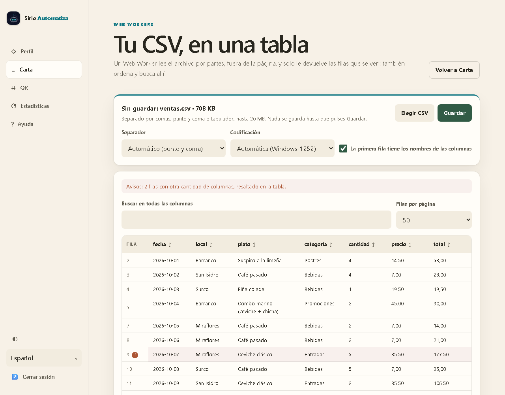
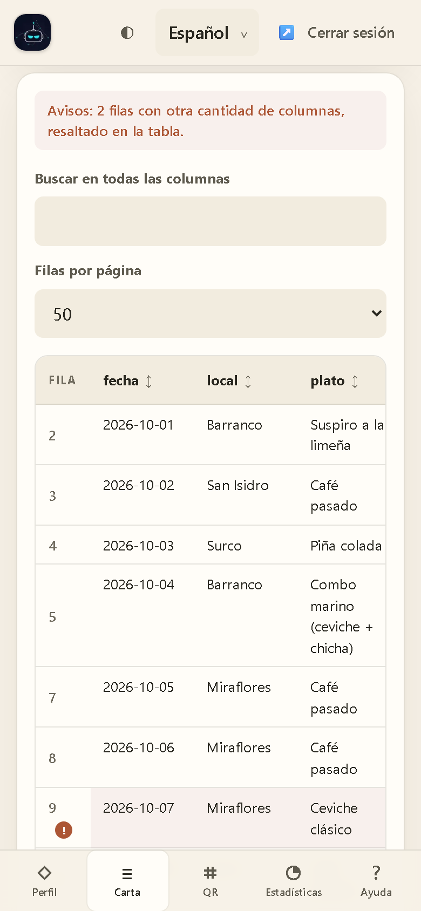
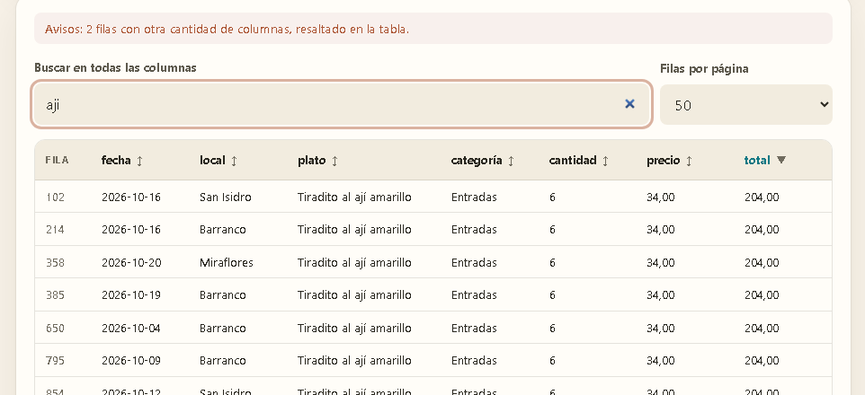
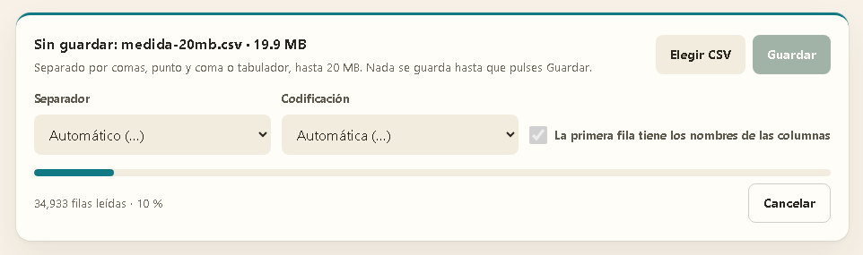
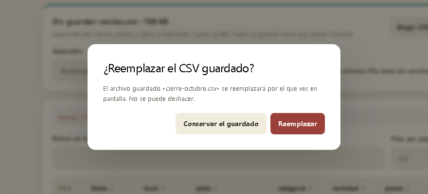
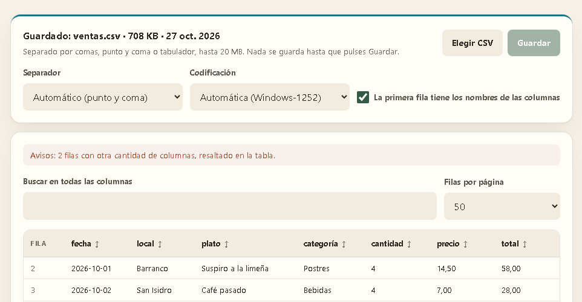
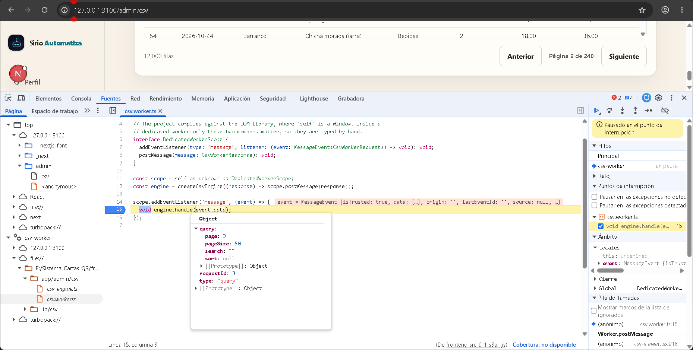

# Informe: Web Workers para leer un CSV en el Sistema de Cartas QR

Este informe explica qué es un Web Worker y cómo se aplicó en el proyecto con un ejemplo concreto: una página del panel del dueño que carga un archivo CSV y lo muestra en una tabla HTML, con todo el trabajo pesado en un worker. Las capturas son del sistema real, levantado con Docker Compose, el 27 de octubre de 2026. La de DevTools se tomó con `next dev` para que el código del worker se lea tal como está escrito.

## 1. Resumen

- La página `/admin/csv`, enlazada desde Carta con «Abrir un CSV», carga un archivo de hasta 20 MB y lo muestra en una tabla paginada. Permite ordenar por cualquier columna, buscar en todas a la vez y elegir 25, 50 o 100 filas por página.
- Un **Web Worker dedicado** hace todo el trabajo pesado: lee el archivo por partes, detecta la codificación y el separador, lo interpreta según RFC 4180, ordena y busca. La página solo recibe mensajes de progreso y las filas que muestra.
- **Guardar** sube el archivo como el CSV del restaurante, que solo tiene uno y pide confirmación antes de reemplazarlo. Al volver a la página, el worker descarga el CSV guardado y lo abre sin que el dueño haga nada.

## 2. Qué es un Web Worker

### 2.1 Un hilo aparte

El JavaScript de una página corre en el **hilo principal**, el mismo que atiende los clics, calcula el diseño y pinta. Mientras una función está en ejecución, nada de eso ocurre. Por eso el W3C llama *tarea larga* a la que pasa de 50 ms: retrasa de forma visible la respuesta al usuario.

Un Web Worker ejecuta un script en un **hilo en segundo plano**, con su propio ámbito global (`DedicatedWorkerGlobalScope`) y su propio bucle de eventos. No tiene acceso al DOM: no existen `document` ni `window`. Sí dispone de `fetch`, `TextDecoder`, los streams, `Intl` y los temporizadores. El ejemplo usa un worker **dedicado**, que pertenece a la página que lo crea; los compartidos sirven a varias pestañas y los *service workers* actúan de proxy de red.

### 2.2 Cómo se comunican

La página y el worker no comparten variables, sino que se envían mensajes:

- **Envío y recepción.** Cada lado llama a `postMessage(dato)` y el otro lo recibe en su evento `message`.
- **Copia estructurada.** El dato viaja copiado con el algoritmo *structured clone*. Acepta objetos, arreglos, `Map`, `Date`, `ArrayBuffer`, y también `File` y `Blob`. Copiar un `File` no lee su contenido: el worker recibe otra referencia a los mismos bytes. Las funciones y los nodos del DOM no se pueden copiar.
- **Transferencia.** Un `ArrayBuffer` se puede transferir en lugar de copiar con `postMessage(dato, [buffer])`, y quien lo envía pierde el acceso. El ejemplo no lo necesita: lo que viaja es un `File` y páginas pequeñas de filas.
- **Errores.** Una excepción no capturada en el worker dispara el evento `error` del objeto `Worker` en la página.
- **Cierre.** `worker.terminate()` lo detiene de inmediato, aunque esté a mitad de un cálculo.

### 2.3 Cómo se crea uno

`new Worker(url, opciones)` carga el script, que debe ser del mismo origen que la página. La opción `type: 'module'` permite usar `import` dentro del worker y `name` le da un nombre visible en DevTools. Con un empaquetador como Turbopack, el patrón `new URL('./archivo', import.meta.url)` hace que el worker se emita como un script propio con sus dependencias:

```js
// pagina.js
const worker = new Worker(new URL('./suma.worker.js', import.meta.url), { type: 'module' });
worker.addEventListener('message', (evento) => console.log('total:', evento.data));
worker.postMessage([1, 2, 3]);

// suma.worker.js: aquí iría el trabajo pesado
self.addEventListener('message', (evento) => {
  self.postMessage(evento.data.reduce((a, b) => a + b, 0));
});
```

### 2.4 Cuándo conviene

Un worker no hace el trabajo más rápido: lo saca del hilo que pinta. Además cuesta arrancar otro contexto de JavaScript, la memoria que ese contexto ocupa y copiar cada mensaje. Conviene cuando el trabajo es largo y los mensajes son chicos. En el ejemplo, el worker guarda todas las filas y responde con una página de como mucho 100: lo que viaja no depende del tamaño del archivo.

## 3. El ejemplo en Sirio

### 3.1 Qué ve el dueño

En **Carta**, el enlace «Abrir un CSV» lleva a `/admin/csv`. El dueño elige un archivo `.csv`, `.tsv` o `.txt` y el worker lo lee mientras una barra muestra las filas leídas y el porcentaje, con **Cancelar** siempre disponible. Al terminar, la página muestra:

- el separador y la codificación detectados, cada uno corregible con su selector;
- la casilla «La primera fila tiene los nombres de las columnas», marcada; sin ella, las columnas se llaman A, B, C…;
- la tabla, con encabezado fijo, una columna «Fila» con el número de línea del archivo y un botón por columna que ordena ascendente, descendente o sin orden;
- la búsqueda en todas las columnas, sin distinguir tildes ni mayúsculas, y un aviso que cuenta y marca las filas con otra cantidad de columnas.

**Guardar** sube el archivo como el CSV del restaurante. Si ya había uno, un diálogo pide confirmar el reemplazo. Al entrar a la página, el CSV guardado se abre solo.

### 3.2 Dónde se agregó

| Capa | Archivo | Qué hace |
|---|---|---|
| Web · worker | [`create-csv-worker.ts`](../frontend/src/app/admin/csv/create-csv-worker.ts#L6) y [`csv.worker.ts`](../frontend/src/app/admin/csv/csv.worker.ts#L14) | Crea el worker con `type: 'module'` y nombre `csv-worker`; el worker pasa cada mensaje al motor |
| Web · protocolo | [`csv-protocol.ts`](../frontend/src/app/admin/csv/csv-protocol.ts#L24) | Mensajes tipados: `open` y `query` hacia el worker; `progress`, `ready`, `page` y `failed` de vuelta ([L31](../frontend/src/app/admin/csv/csv-protocol.ts#L31)) |
| Web · motor | [`csv-engine.ts`](../frontend/src/app/admin/csv/csv-engine.ts#L43) | Lee por partes ([L71](../frontend/src/app/admin/csv/csv-engine.ts#L71)), detecta con los primeros 64 KiB ([L77](../frontend/src/app/admin/csv/csv-engine.ts#L77)), interpreta ([L101](../frontend/src/app/admin/csv/csv-engine.ts#L101)), informa el progreso ([L117](../frontend/src/app/admin/csv/csv-engine.ts#L117)) y responde páginas ([L164](../frontend/src/app/admin/csv/csv-engine.ts#L164)) |
| Web · CSV | [`parser.ts`](../frontend/src/lib/csv/parser.ts#L38), [`detect.ts`](../frontend/src/lib/csv/detect.ts#L15), [`query.ts`](../frontend/src/lib/csv/query.ts#L98) | Parser RFC 4180 incremental; detección de codificación y de separador ([L29](../frontend/src/lib/csv/detect.ts#L29)); orden por tipo ([L54](../frontend/src/lib/csv/query.ts#L54)) y búsqueda sin tildes |
| Web · pantalla | [`csv-viewer.tsx`](../frontend/src/app/admin/csv/csv-viewer.tsx#L115) | Crea el worker y escucha sus respuestas; pide cada página ([L212](../frontend/src/app/admin/csv/csv-viewer.tsx#L212)), cancela con `terminate()` ([L250](../frontend/src/app/admin/csv/csv-viewer.tsx#L250)) y guarda ([L280](../frontend/src/app/admin/csv/csv-viewer.tsx#L280)) |
| Web · BFF | [`csv/route.ts`](../frontend/src/app/api/owner/restaurants/[restaurantId]/csv/route.ts#L24) y [`content/route.ts`](../frontend/src/app/api/owner/restaurants/[restaurantId]/csv/content/route.ts#L7) | `PUT` con verificación de origen y límite de 20 MB; `GET` del contenido reenviado por partes, con `request.signal` |
| API | [`csv-files.controller.ts`](../backend/src/csv-files/csv-files.controller.ts#L38) | Datos del archivo, contenido con `pipeline` ([L64](../backend/src/csv-files/csv-files.controller.ts#L64)) y subida ([L91](../backend/src/csv-files/csv-files.controller.ts#L91)), solo para el dueño del restaurante |
| API · aplicación | [`csv-file.use-cases.ts`](../backend/src/csv-files/application/use-cases/csv-file.use-cases.ts#L8) y [`local-csv-file.storage.ts`](../backend/src/csv-files/infrastructure/local-csv-file.storage.ts#L22) | Guarda el archivo nuevo, cambia el registro en una transacción y después borra el anterior |
| Datos y gateway | [`schema.prisma`](../backend/prisma/schema.prisma#L75) y [`nginx.conf`](../docker/nginx.conf#L57) | Tabla `RestaurantCsvFile`, una fila por restaurante; 21 MB de cuerpo solo para esta ruta |

### 3.3 Recorrido de un archivo

```text
<input type="file">          File: la página no lee su contenido
  → postMessage(open)        copia estructurada: viaja la referencia, no los bytes
  → worker                   file.stream() → bloques de bytes
  → primeros 64 KiB          codificación (UTF-8 o Windows-1252) y separador (, ; tab)
  → TextDecoder              decode(bloque, { stream: true })
  → parser RFC 4180          filas guardadas en la memoria del worker
  → postMessage(progress)    como mucho cada 100 ms
  → postMessage(ready)       columnas, filas, avisos, tiempo
página → postMessage(query)  página, tamaño, búsqueda, orden, requestId
  → worker                   filtra, ordena (con caché) y recorta
  → postMessage(page)        como mucho 100 filas → React pinta la tabla
```

**1. La página crea el worker y solo reacciona a sus mensajes.** El `new Worker(...)` vive en un módulo propio porque Jest, que corre en CommonJS, no conoce `import.meta`; las pruebas de la pantalla lo reemplazan por un worker falso.

**2. El worker lee el archivo por partes.** Tanto un archivo local (`file.stream()`) como el CSV guardado (`response.body`) son un `ReadableStream`, así que el motor los trata igual. Cada bloque se decodifica con `stream: true`, que guarda los bytes de un carácter partido para el bloque siguiente. El parser, a su vez, conserva entre llamadas el campo a medio leer, las comillas abiertas y un `\r` cuyo `\n` puede llegar después:

```ts
const { done, value } = await reader.read();
if (run !== generation) return;              // otro archivo reemplazó a este
if (done) break;
bytesRead += value.length;
parser.push(decoder.decode(value, { stream: true }));
if (now() - lastProgress >= progressEveryMs) progress();
```

**3. Solo viaja una página.** Cada vez que cambian la página, la búsqueda o el orden, la pantalla envía `{ type: 'query', query, requestId }` con lo que va a mostrar. Numera cada pregunta y solo acepta la respuesta a la última, así que una búsqueda escrita rápido no muestra resultados viejos.

### 3.4 Codificación y separador

- **Codificación.** UTF-8 es estricto con sus secuencias de bytes y Windows-1252, que es lo que Excel en español guarda como «CSV», no lo es. El worker decodifica los primeros 64 KiB con `TextDecoder('utf-8', { fatal: true })`. Si falla, usa Windows-1252. La opción `stream: true` evita que un carácter cortado justo al final de la muestra cuente como error.
- **Separador.** Se interpretan los primeros 20 registros con cada candidato (`,`, `;` y tabulador) y gana el que parte la mayoría en la misma cantidad de celdas. En un archivo con `;`, un precio como «35,50» también se parte con la coma, pero de forma irregular, así que la coma pierde.
- **Corrección.** Si el dueño cambia el separador o la codificación, el worker vuelve a leer el mismo `File`, sin otra subida.

### 3.5 Ordenar y buscar

- **Orden por tipo.** Los números se comparan como números («1,5» vale lo mismo que «1.5») y el texto con `Intl.Collator('es')`, que ignora las tildes y pone la «ñ» después de la «n». Los números van antes que el texto y las celdas vacías siempre al final.
- **Valor calculado una vez.** El worker calcula el valor de cada celda y la posición de cada texto distinto una sola vez por orden, así que comparar dos filas es comparar dos números. Medido en Node, ordenar 347 550 filas por total tarda unos 0,37 s, frente a 1,4 s comparando las celdas directamente.
- **Búsqueda.** Abarca todas las columnas en minúsculas y sin tildes: «aji» encuentra «Ají». La primera búsqueda prepara el texto de todas las filas (unos 0,8 s con 347 550, también en Node) y las siguientes lo reutilizan.
- **Caché del orden.** El orden filtrado queda guardado, así que pasar de página no vuelve a buscar ni a ordenar.

### 3.6 Cancelar y reemplazar

- **Cancelar** llama a `worker.terminate()`, que detiene el hilo aunque esté a mitad de un cálculo síncrono. La siguiente lectura crea un worker nuevo.
- **Otro archivo mientras se lee el anterior.** El motor numera cada lectura: la anterior se abandona y su lector se cancela.

### 3.7 Guardar y abrir el CSV del restaurante

- **Guardar.** El navegador envía un `PUT` multipart al BFF, que verifica el origen y rechaza con `413` lo que supere 20 MB. La API exige un dueño del restaurante, valida el archivo y lo escribe en el volumen como `restaurants/<restaurante>/csv/<uuid>.csv`, primero en un temporal que después renombra. Una transacción apunta `RestaurantCsvFile` al archivo nuevo y solo después se borra el anterior; si ese borrado falla, la copia se va con la carpeta del restaurante.
- **Abrir al entrar.** Si hay un CSV guardado, la página le envía al worker la dirección del contenido y es **el propio worker** el que hace el `fetch`. Es del mismo origen, así que la cookie de sesión viaja sola. Lee el cuerpo por partes igual que un archivo local, y `Content-Length` le permite calcular el porcentaje. Los bytes llegan tal como se guardaron (`text/csv` sin `charset`) y el worker vuelve a detectar la codificación.
- **Nginx.** El límite general de cuerpo es de 16 MB. Solo la ruta del CSV admite 21 MB: los 20 del archivo más el envoltorio multipart.

### 3.8 Seguridad y límites

- **Acceso.** Las rutas exigen sesión de dueño y pasan por `OwnerRestaurantGuard`: el CSV de un restaurante ajeno responde `403`.
- **Tamaño.** Los 20 MB se verifican en la página antes de leer (un archivo mayor ni siquiera llega al worker), en el BFF y en la API.
- **Contenido.** Un CSV no tiene firma binaria que comprobar. La API exige la extensión y rechaza con `400` cualquier byte nulo, que solo aparece en archivos binarios o en texto UTF-16.
- **Celdas como texto.** El worker no toca el DOM y React inserta cada celda como texto, así que una celda con `<script>` se muestra y no se ejecuta.

## 4. Evidencia

**Figura 1.** Un CSV con el formato que guarda Excel en español (punto y coma y Windows-1252), de 12 000 filas, en escritorio.

En la figura se ven:

- el separador y la codificación detectados;
- el aviso por 2 filas con una columna de más, con su marca en la fila 9;
- en la fila 5, una celda con un salto de línea entre comillas.



**Figura 2.** El mismo archivo en un teléfono de 390 px.

En el teléfono, la tabla se desplaza de lado dentro de su caja y la navegación del panel pasa a la barra inferior.



**Figura 3.** Búsqueda «aji», sin tilde, y orden por total descendente: las ventas de «Tiradito al ají amarillo» de 204,00 aparecen primero, con su número de línea original:



**Figura 4.** Un archivo de 19,9 MB mientras el worker lo lee: 34 933 filas al 10 %, con **Cancelar** disponible:



**Figura 5.** Guardar sobre un CSV ya guardado pide confirmación y nombra el archivo que se perderá:



**Figura 6.** Al volver a la página, el CSV guardado se abre solo: el worker lo descargó y lo volvió a detectar:



**Figura 7.** Chrome DevTools, panel Fuentes, con un punto de interrupción en el worker:

- **Hilos** muestra dos: «csv-worker» está en pausa y «Principal» no.
- El mensaje recibido, `event.data`, es la pregunta por la página 3: `{ type: "query", requestId: 3, query: { page: 3, pageSize: 50, search: "", sort: null } }`.
- La pila de llamadas cruza de hilo: de `csv.worker.ts:15` pasa por `Worker.postMessage` hasta `csv-viewer.tsx:216`, en la página.
- La página sigue mostrando «Página 2 de 240» mientras espera la respuesta.



## 5. Mediciones

Chromium sin interfaz (Playwright), contra la compilación de producción en Compose; mediana de 3 corridas por archivo. Se tomaron dos medidas:

- **Hasta ver la tabla:** desde el `change` del selector de archivo hasta la primera fila en el DOM.
- **Mayor retraso del hilo principal:** el peor atraso de un temporizador de 10 ms que corre en la página mientras tanto.

| Archivo | Filas | Hasta ver la tabla | Mayor retraso del hilo principal |
|---|---|---|---|
| 1 MB | 17 459 | 47 ms | 30 ms |
| 5 MB | 87 326 | 149 ms | 10 ms |
| 20 MB | 347 550 | 448 ms | 33 ms |

Con el worker, el mayor atraso del hilo de la página en las nueve corridas fue de 36 ms, con el archivo de 20 MB. Ese hilo solo pinta el progreso y la tabla, porque la interpretación ocurre en el worker, así que la página puede mover la barra y atender **Cancelar** durante toda la lectura.

Además de la lectura, el worker absorbe dos operaciones que son un solo bloque síncrono. Con las 347 550 filas, medidas con el mismo módulo en Node (mediana de 3), ordenar tarda unos 0,37 s y la primera búsqueda unos 0,8 s. En el hilo de la página serían entre 20 y 50 fotogramas sin pintar ni responder.

## 6. Pruebas

| Prueba | Qué verifica |
|---|---|
| [`parser.test.ts`](../frontend/src/lib/csv/parser.test.ts) | Comillas con separadores, comillas dobles y saltos de línea; el mismo resultado sea cual sea el tamaño de los trozos; líneas vacías y un `\r` antes de cerrar comillas |
| [`detect.test.ts`](../frontend/src/lib/csv/detect.test.ts) | UTF-8 frente a Windows-1252; `,`, `;` y tabulador, sin confundirse con comas decimales ni con separadores entre comillas |
| [`query.test.ts`](../frontend/src/lib/csv/query.test.ts) | Números con coma o punto, orden por tipo y del español, búsqueda sin tildes, empates en el orden del archivo y página fuera de rango |
| [`csv-engine.test.ts`](../frontend/src/app/admin/csv/csv-engine.test.ts) | Detección de un CSV de Excel y marca de sus filas; opciones forzadas; progreso; descarga del CSV guardado; fallos |
| [`csv-viewer.test.tsx`](../frontend/src/app/admin/csv/csv-viewer.test.tsx) | Con un worker falso: abrir al entrar, ordenar, guardar tras confirmar, releer con otro separador, **Cancelar** y el límite de 20 MB |
| [Pruebas de la API](../backend/src/csv-files/) | Validación del archivo, orden de guardar y reemplazar, almacenamiento con temporal y descarga con cierre prematuro |
| [`csv-files.spec.ts`](../tests/e2e/csv-files.spec.ts#L79) (E2E) | Contra el stack real: guardar, devolver intacto y reemplazar (nombre acentuado, bytes Windows-1252); `400`, `403` y `413`; contenido por partes en el BFF |
| [`csv-viewer.spec.ts`](../tests/e2e/csv-viewer.spec.ts#L78) (E2E) | En escritorio, Android e iPhone: el CSV de Excel desde Carta, y guardar, reabrir al entrar y confirmar el reemplazo |

Al cerrar el ejemplo pasaban las 264 pruebas unitarias de la API, las 336 de la web y las 77 del paquete compartido, y las specs E2E del CSV pasaron en los tres perfiles.

## 7. Conclusión

Un Web Worker ejecuta JavaScript fuera del hilo que pinta: se crea con `new Worker`, se comunica solo por mensajes copiados y se detiene con `terminate()`. No acelera el trabajo, pero evita que la página se congele mientras lo hace. El ejemplo lo aplica a un caso real del proyecto con la regla que lo hace rentable: el trabajo pesado y los datos se quedan en el worker y a la página solo llegan mensajes pequeños. Las mediciones y DevTools lo confirman: un archivo de 20 MB se lee sin que la página se atrase más de 36 ms, ordenar y buscar ocurren lejos del hilo que congelarían hasta casi un segundo, y con el worker detenido en un punto de interrupción el hilo principal sigue en marcha.

## 8. Fuentes

- MDN, [Using Web Workers](https://developer.mozilla.org/en-US/docs/Web/API/Web_Workers_API/Using_web_workers), [`Worker()`](https://developer.mozilla.org/en-US/docs/Web/API/Worker/Worker) (`type`, `name`), [`Worker.terminate()`](https://developer.mozilla.org/en-US/docs/Web/API/Worker/terminate) y [`DedicatedWorkerGlobalScope`](https://developer.mozilla.org/en-US/docs/Web/API/DedicatedWorkerGlobalScope).
- MDN, [The structured clone algorithm](https://developer.mozilla.org/en-US/docs/Web/API/Web_Workers_API/Structured_clone_algorithm) y [Transferable objects](https://developer.mozilla.org/en-US/docs/Web/API/Web_Workers_API/Transferable_objects).
- MDN, [`TextDecoder.decode()`](https://developer.mozilla.org/en-US/docs/Web/API/TextDecoder/decode) (`fatal`, `stream`) y [`Blob.stream()`](https://developer.mozilla.org/en-US/docs/Web/API/Blob/stream).
- WHATWG, HTML Living Standard, sección [Web workers](https://html.spec.whatwg.org/multipage/workers.html).
- W3C, [Long Tasks API](https://w3c.github.io/longtasks/): una tarea de más de 50 ms es una tarea larga.
- IETF, [RFC 4180](https://www.rfc-editor.org/rfc/rfc4180): formato de los archivos CSV.
- Next.js, [referencia de Turbopack](https://nextjs.org/docs/app/api-reference/turbopack): `new Worker()` y `new URL(..., import.meta.url)`.
