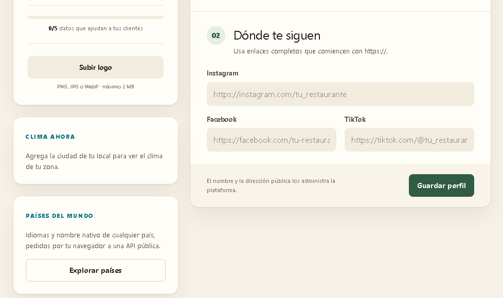
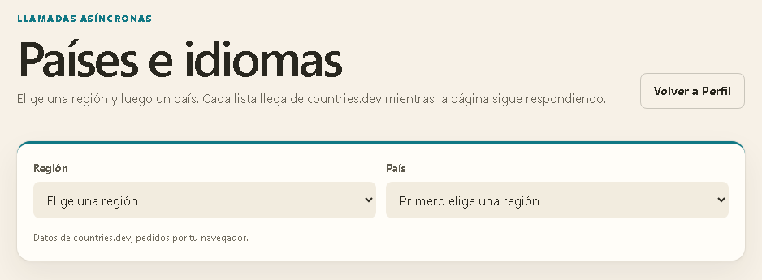
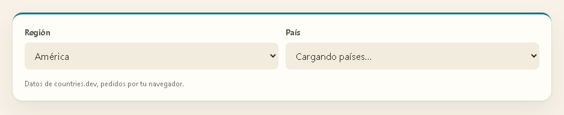
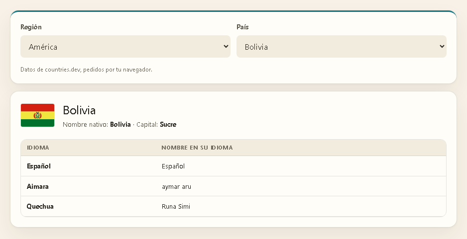
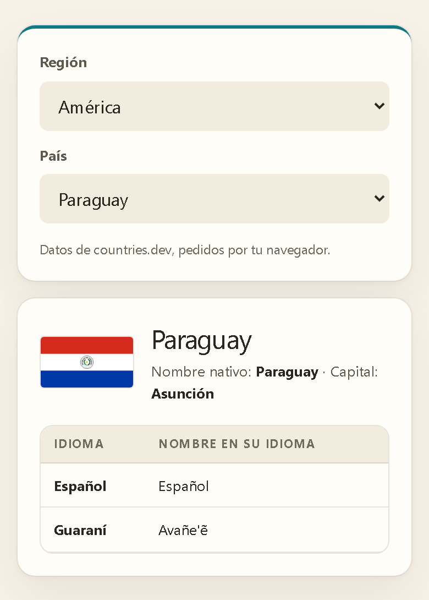
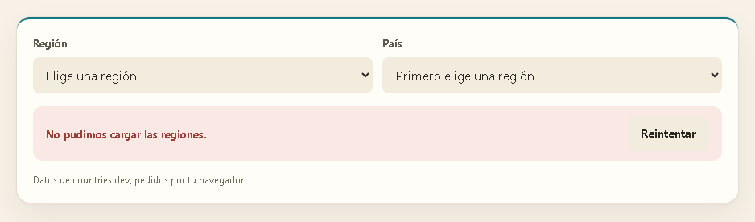
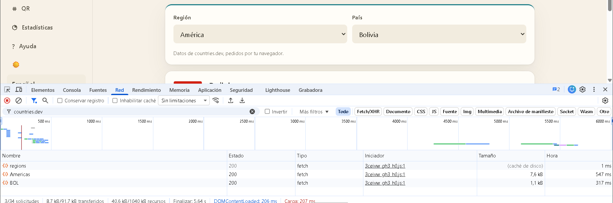
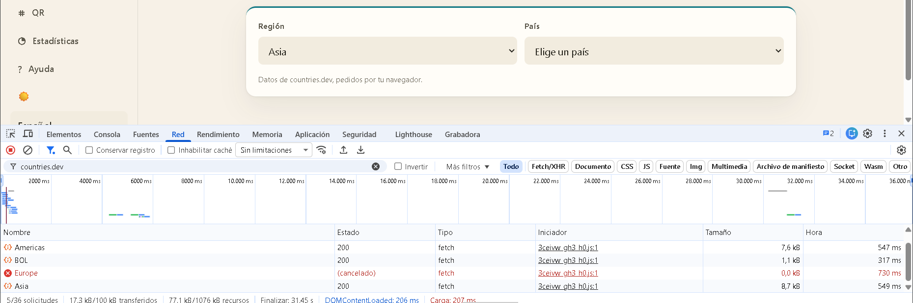

# Informe: llamadas asíncronas en JavaScript en el Sistema de Cartas QR

Este informe explica cómo funcionan las llamadas asíncronas en JavaScript (promesas, `async/await`, `fetch` y su cancelación) y cómo se aplicaron en el proyecto con el ejemplo pedido: una vista con dos listas desplegables, Región y País, y una tabla con los idiomas y el nombre nativo del país elegido. Las capturas son del sistema real, levantado con Docker Compose, el 27 de octubre de 2026, contra la API pública countries.dev.

## 1. Resumen

- La vista `/admin/countries`, enlazada desde Perfil con la tarjeta «Países del mundo», hace tres llamadas encadenadas a countries.dev, desde el propio navegador y con `fetch` y `async/await`:
  - las regiones, al abrirse;
  - los países de una región, al elegirla;
  - el detalle de un país, al elegirlo.
- La tabla tiene una fila por idioma, con su nombre en esa lengua. La encabezan el nombre nativo del país, su bandera y su capital.
- Cada elección nueva cancela con `AbortController` la llamada que reemplaza. Una llamada que falla dice cuál fue y ofrece «Reintentar», y la última elección se recuerda en el dispositivo.
- La API que pedía el enunciado, restcountries.com v3.1, ya no funciona. Se usó la alternativa que el enunciado permitía, apicountries.com, que hoy es countries.dev.

## 2. Llamadas asíncronas en JavaScript

### 2.1 Un solo hilo que no espera

El JavaScript de una página corre en un solo hilo: el mismo que pinta y atiende los clics. Pedir datos a un servidor tarda cientos de milisegundos, y si el hilo se quedara esperando, la página se congelaría.

Por eso las operaciones de red son asíncronas. El navegador hace la petición por su cuenta y, cuando llega la respuesta, encola la continuación del código; mientras tanto el hilo sigue libre para pintar y responder.

### 2.2 Promesas y async/await

- **Promesa.** Una `Promise` representa un valor que llegará más tarde. Está pendiente, cumplida (con un valor) o rechazada (con un error), y con `then` se encadena lo que sigue.
- **`async`.** Una función `async` siempre devuelve una promesa.
- **`await`.** Dentro de una función `async`, `await` la suspende hasta que la promesa se resuelve, sin bloquear el hilo: el resto de la página sigue funcionando.
- **Errores.** Un rechazo se convierte en una excepción que se captura con `try/catch`.

```js
async function idiomas(codigo) {
  const respuesta = await fetch(`https://countries.dev/alpha/${codigo}`);
  if (!respuesta.ok) throw new Error(`La API respondió ${respuesta.status}`);
  const pais = await respuesta.json();
  return pais.languages.map((idioma) => idioma.nativeName);
}

idiomas('BOL').then(console.log); // ["Español", "aymar aru", "Runa Simi"]
```

### 2.3 fetch

- `fetch(url, opciones)` devuelve una promesa que se cumple con un `Response` en cuanto llegan las cabeceras.
- Esa promesa solo se rechaza si la petición falla: sin conexión, un nombre que no resuelve o una respuesta que CORS no deja leer. Un `404` o un `500` **cumplen** la promesa, así que hay que mirar `response.ok` o `response.status`.
- Leer el cuerpo también es asíncrono: `await response.json()`.

### 2.4 Cancelar con AbortController

Si el dueño cambia de región antes de que llegue la respuesta, quedan dos llamadas en curso, y la vieja podría llegar después que la nueva y pisar la lista correcta. `AbortController` evita esa carrera:

1. Su `signal` se pasa a `fetch`.
2. `controller.abort()` cancela la petición.
3. La promesa se rechaza con un `AbortError`, que para el usuario no es un fallo.

### 2.5 CORS

La página, en `http://127.0.0.1:3000` o en el dominio de producción, pide datos a otro origen: `https://countries.dev`. El navegador solo deja leer la respuesta si trae `Access-Control-Allow-Origin` con ese origen o `*`.

countries.dev responde `*`, así que el navegador la lee directamente, sin pasar por el servidor del proyecto. La v5 de restcountries, en cambio, rechaza los orígenes que no estén registrados en la clave de quien la usa.

## 3. El ejemplo en Sirio

### 3.1 Qué ve el dueño

En **Perfil**, bajo la tarjeta «Clima ahora», la tarjeta «Países del mundo» lleva a `/admin/countries`.

1. La vista abre con la lista de regiones cargándose y la de países deshabilitada («Primero elige una región»).
2. Al elegir una región, la lista de países muestra «Cargando países…» y luego los países, con sus nombres en español y en orden alfabético.
3. Al elegir un país aparecen su bandera, su nombre nativo y su capital, y una tabla con una fila por idioma: el idioma y su nombre en esa lengua.

Si una llamada falla, un aviso dice cuál y ofrece «Reintentar».

### 3.2 La API: countries.dev

El enunciado pedía `https://restcountries.com/v3.1`. Hoy esa versión ya no funciona:

- **v3.1.** Cualquier ruta redirige a un JSON que dice «This API version has been deprecated» y pide migrar a v5.
- **v5.** Exige crear una cuenta y una API key. Desde el navegador, además, el origen de la página debe estar registrado en la clave. Con la clave de demostración responde `403 originNotAllowed`, y desde el servidor devuelve un solo país de ejemplo.
- **La alternativa.** El enunciado permitía `apicountries.com`, que hoy redirige a **countries.dev**. Es pública, no pide clave, responde con `Access-Control-Allow-Origin: *` y permite guardar las respuestas una hora en caché.

| Llamada | Cuándo | Qué devuelve |
|---|---|---|
| `GET /regions` | Al abrir la vista | 8 regiones; se ocultan Antarctic, Antarctic Ocean y Polar, que tienen un territorio cada una |
| `GET /region/{región}` | Al elegir una región | Los países de esa región (57 en América), con nombre y códigos ISO |
| `GET /alpha/{código}` | Al elegir un país | El país: `nativeName`, `capital`, `flags` y `languages`, donde cada idioma trae `name`, `nativeName` e `iso639_1` |

### 3.3 Dónde se agregó

| Capa | Archivo | Qué hace |
|---|---|---|
| Cliente de la API | [`countries.ts`](../frontend/src/lib/countries.ts#L78) | Las tres llamadas (L78–L88) sobre `requestJson` ([L101](../frontend/src/lib/countries.ts#L101)) y la lectura defensiva de cada respuesta ([L52](../frontend/src/lib/countries.ts#L52)) |
| Nombres | [`format.ts`](../frontend/src/i18n/format.ts#L65) | Países e idiomas con `Intl.DisplayNames`; orden con `Intl.Collator` ([L56](../frontend/src/i18n/format.ts#L56)) |
| Vista | [`countries-explorer.tsx`](../frontend/src/app/admin/countries/countries-explorer.tsx#L94) | El hook `useRemote` ([L68](../frontend/src/app/admin/countries/countries-explorer.tsx#L68)), las tres llamadas encadenadas ([L99](../frontend/src/app/admin/countries/countries-explorer.tsx#L99)), el aviso con «Reintentar» ([L138](../frontend/src/app/admin/countries/countries-explorer.tsx#L138)) y la tabla ([L228](../frontend/src/app/admin/countries/countries-explorer.tsx#L228)) |
| Enlace | [`countries-card.tsx`](../frontend/src/app/admin/countries/countries-card.tsx) | La tarjeta de Perfil, bajo el clima ([`restaurant-profile-panel.tsx`](../frontend/src/app/admin/restaurant-profile-panel.tsx#L280)) |
| Textos | [`owner-countries.ts`](../frontend/src/i18n/messages/owner-countries.ts) | La interfaz en español e inglés, y los nombres de los continentes |

### 3.4 Recorrido de las tres llamadas

```text
Abrir /admin/countries
  → GET /regions             → 5 regiones en la primera lista
Elegir «América»
  → GET /region/Americas     → 57 países en la segunda lista
Elegir «Bolivia»
  → GET /alpha/BOL           → bandera, capital, nombre nativo y tabla de idiomas
Elegir otra región antes de que responda
  → abort() de la anterior   → su respuesta nunca llega a la pantalla
```

**1. Una función por llamada.** Las tres pasan por la misma función, que revisa el estado HTTP antes de leer el cuerpo:

```ts
async function requestJson(url: string, signal?: AbortSignal): Promise<unknown> {
  const response = await fetch(url, { signal });
  if (!response.ok) throw new CountriesUnavailableError(`countries.dev answered ${response.status}`);
  return response.json();
}
```

**2. Un hook que pide, cancela y descarta lo viejo.** React ejecuta el efecto cada vez que cambia lo que hay que pedir. Antes de la llamada nueva, la limpieza del efecto anterior cancela la suya. Cada resultado se guarda con la clave que lo pidió, y la vista solo muestra el que corresponde a la clave actual; mientras tanto muestra «cargando».

```ts
useEffect(() => {
  if (input === null || key === null) return;
  const controller = new AbortController();
  load(input, controller.signal).then(
    (value) => setResult({ key, state: { status: 'ready', value } }),
    () => {
      // An aborted call is not a failure: a newer one took its place.
      if (!controller.signal.aborted) setResult({ key, state: { status: 'error' } });
    },
  );
  return () => controller.abort();
}, [input, key, load]);
```

**3. Encadenadas.** Cada llamada empieza cuando la anterior entregó lo que necesita, y un `null` significa que todavía no hay nada que pedir:

```ts
const regions = useRemote('regions', loadRegions);
const region = regionList.includes(selection.region) ? selection.region : '';
const countries = useRemote(region || null, fetchCountries);
const chosen = countryOptions.find((option) => option.value === selection.country);
const detail = useRemote(chosen ? chosen.value : null, fetchCountry);
```

### 3.5 Errores y reintento

- **Llamada fallida.** Una falla de red o un estado HTTP que no es 2xx marca esa llamada como fallida. La vista dice cuál fue («No pudimos cargar las regiones.», «…los países de esta región.» o «…Bolivia.») y «Reintentar» repite solo esa: el hook suma un intento a su clave.
- **Respuestas incompletas.** Se leen con cuidado: un país sin códigos o sin nombre se omite, y una bandera que no sea `https` se ignora.
- **Cancelaciones.** Una llamada cancelada no muestra ningún error.

### 3.6 Nombres en el idioma del panel

- **Países e idiomas.** La API responde en inglés, y el navegador los nombra en el idioma del panel con `Intl.DisplayNames`: «PE» es «Perú» y «gn», «guaraní». La lista se ordena con `Intl.Collator`, así que «Perú» queda después de «Paraguay».
- **Continentes.** Chrome no trae nombres para los códigos M.49 de los continentes, como «019», aunque Node sí. Por eso los cinco continentes salen de los textos de la interfaz. La prueba en el navegador real lo detectó; las unitarias, que corren en Node, no podían.
- **Pronunciación.** Cada nombre en su lengua lleva su atributo `lang` (por ejemplo, `lang="qu"` en «Runa Simi»), para que un lector de pantalla lo pronuncie bien.

### 3.7 Recordar la elección

Cada cambio guarda la región y el país en `localStorage`, solo en ese dispositivo. Al volver, los valores recordados solo cuentan cuando llega la lista a la que pertenecen, así que las tres llamadas se repiten en el mismo orden. Si el navegador no deja guardar, como en una ventana privada, la vista funciona igual y simplemente no recuerda.

## 4. Evidencia

**Figura 1.** Perfil, con la tarjeta «Países del mundo» bajo «Clima ahora»:



**Figura 2.** La vista recién abierta: las cinco regiones ya llegaron y la lista de países espera una región:



**Figura 3.** Mientras llegan los países de América, la segunda lista dice «Cargando países…». Para la captura se retuvo la respuesta; la llamada real tarda medio segundo:



**Figura 4.** Bolivia: bandera, nombre nativo, capital y sus tres idiomas, cada uno con su nombre en esa lengua:



**Figura 5.** En un teléfono de 390 px, Paraguay con español y guaraní («Avañe'ẽ»):



**Figura 6.** Con countries.dev inalcanzable (simulado), la vista dice qué llamada falló y ofrece «Reintentar»:



**Figura 7.** Chrome DevTools, panel Red, filtrado por countries.dev: `regions`, `Americas` y `BOL`, en ese orden, las tres de tipo `fetch`, con estado 200 e iniciadas por el código de la página. La de regiones salió de la caché del navegador, porque countries.dev permite guardarla una hora; las otras dos tardaron 547 y 317 ms:



**Figura 8.** Se eligió Europa y, antes de que respondiera (se retuvo 3 s a propósito), Asia. La llamada de Europa queda «(cancelado)» y solo la de Asia llega a la lista:



## 5. Pruebas

| Prueba | Qué verifica |
|---|---|
| [`countries.test.ts`](../frontend/src/lib/countries.test.ts) | Direcciones, regiones ocultas, países incompletos que se omiten, un país con idiomas, bandera y capital, solo banderas `https`, la señal de cancelación que llega a `fetch` y el error ante un estado HTTP de fallo |
| [`countries-explorer.test.tsx`](../frontend/src/app/admin/countries/countries-explorer.test.tsx) | Regiones al entrar, en español y ordenadas; países al elegir región; tabla por idioma con su `lang`; la llamada de una región abandonada se cancela y no pisa la nueva; «Reintentar»; recordar y repetir las llamadas en orden; la interfaz en inglés |
| [`restaurant-profile-panel.test.tsx`](../frontend/src/app/admin/restaurant-profile-panel.test.tsx) | La tarjeta enlaza a `/admin/countries` sin llamar a countries.dev desde Perfil |
| [`countries.spec.ts`](../tests/e2e/countries.spec.ts) (E2E) | Contra el stack real en escritorio, Android e iPhone, con countries.dev interceptada: tarjeta, región, país y tabla; las llamadas son `GET fetch` de la página y van en orden; otra región vacía la tabla; recordar al recargar y «Reintentar» con la API caída |

Al cerrar el ejemplo pasaban las 264 pruebas unitarias de la API, las 355 de la web y las 77 del paquete compartido. La suite E2E completa dio 165 pruebas en verde y 4 omitidas por diseño, y la spec de países pasó en los tres perfiles.

## 6. Conclusión

En JavaScript, una llamada a un servidor no detiene la página: `fetch` devuelve una promesa y `async/await` permite escribir lo que sigue como si fuera secuencial, sin bloquear el hilo. Hacerlo bien exige, además, revisar el estado HTTP, porque un `404` no rechaza la promesa, y cancelar las llamadas que quedaron viejas para que no pisen a las nuevas.

El ejemplo aplica esas piezas a lo que pedía el enunciado: al elegir una región se recarga la lista de países y al elegir un país se muestra la tabla con sus idiomas y su nombre nativo. Las tres llamadas encadenadas se ven en DevTools, y las pruebas cubren el orden, la cancelación y los errores.

## 7. Fuentes

- MDN, [Using the Fetch API](https://developer.mozilla.org/en-US/docs/Web/API/Fetch_API/Using_Fetch) y [`Response.ok`](https://developer.mozilla.org/en-US/docs/Web/API/Response/ok).
- MDN, [Using promises](https://developer.mozilla.org/en-US/docs/Web/JavaScript/Guide/Using_promises), [`async function`](https://developer.mozilla.org/en-US/docs/Web/JavaScript/Reference/Statements/async_function) y [`await`](https://developer.mozilla.org/en-US/docs/Web/JavaScript/Reference/Operators/await).
- MDN, [`AbortController`](https://developer.mozilla.org/en-US/docs/Web/API/AbortController) y [Cross-Origin Resource Sharing (CORS)](https://developer.mozilla.org/en-US/docs/Web/HTTP/Guides/CORS).
- MDN, [`Intl.DisplayNames`](https://developer.mozilla.org/en-US/docs/Web/JavaScript/Reference/Global_Objects/Intl/DisplayNames) y [`Window.localStorage`](https://developer.mozilla.org/en-US/docs/Web/API/Window/localStorage).
- countries.dev, [documentación de la API](https://countries.dev/docs/api/region).
- restcountries.com, [aviso de deprecación de las versiones anteriores](https://restcountries.com/docs/countries/legacy-api-deprecation).
