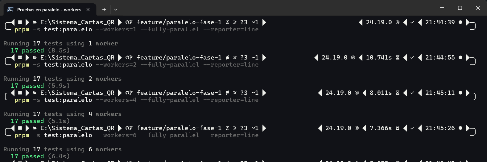
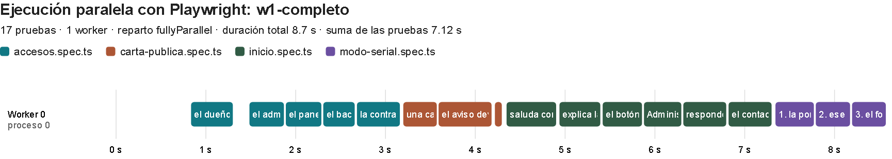
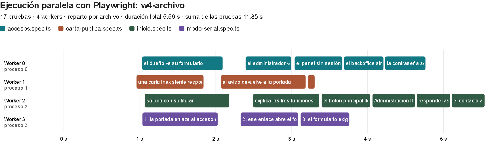
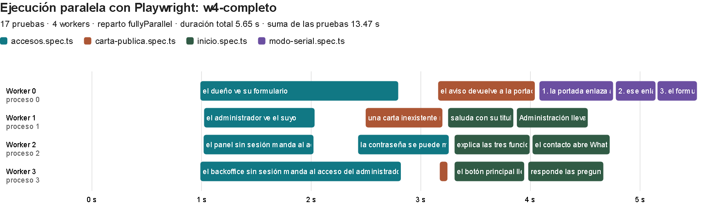
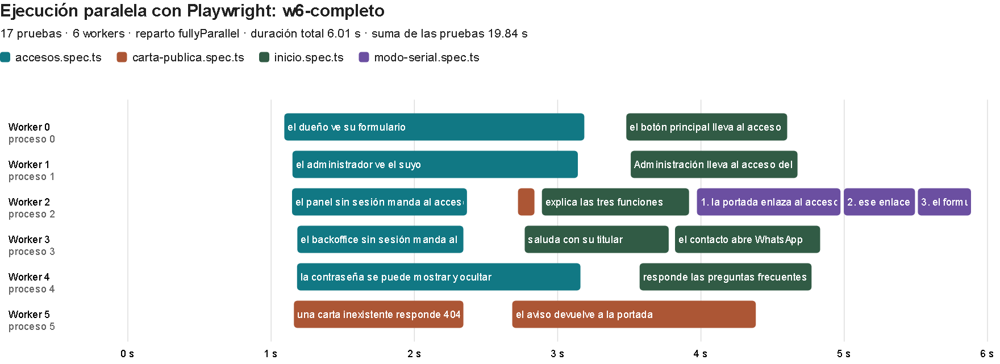
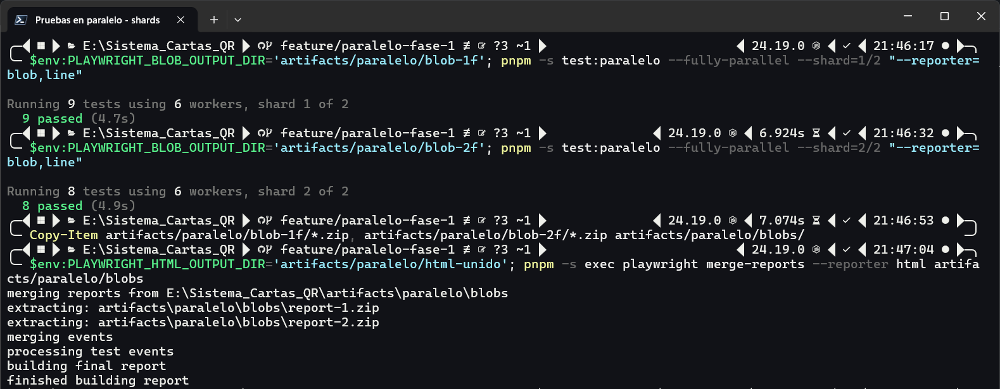
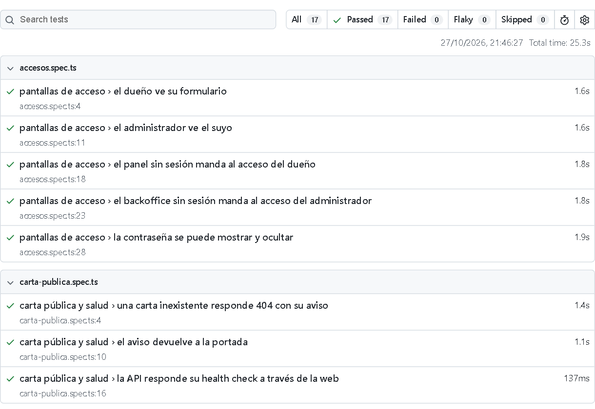
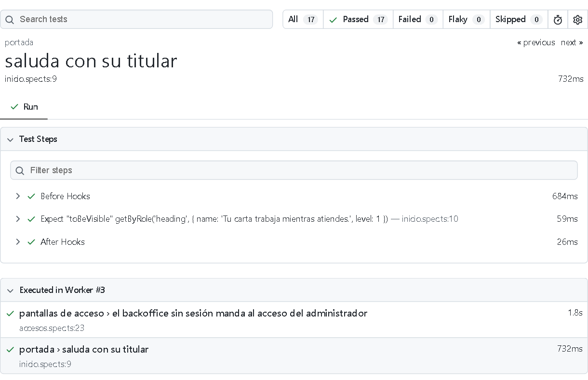

# Informe: ejecución paralela de pruebas con Playwright en el Sistema de Cartas QR

Este informe elige una herramienta de pruebas automatizadas con ejecución paralela, explica cómo reparte el trabajo, ejecuta un ejemplo sencillo sobre el proyecto y muestra la evidencia. Las mediciones y capturas se tomaron el 27 de octubre de 2026 en una máquina con Windows 11 y 12 núcleos lógicos, contra el sistema levantado con Docker Compose.

## 1. Resumen

- **Herramienta:** Playwright Test 1.62, que el proyecto ya usa para su suite E2E.
- **Cómo paraleliza:** cada *worker* es un proceso del sistema con su propio navegador.
  - Por defecto reparte archivos entre workers, y las pruebas de un mismo archivo van en orden en el mismo worker.
  - Con `fullyParallel` reparte pruebas sueltas.
  - El modo `serial` mantiene juntas las pruebas que dependen entre sí.
  - `--shard` divide la suite entre varias máquinas.
- **Ejemplo:** 17 pruebas de solo lectura en 4 archivos de [`tests/paralelo/`](../tests/paralelo/), con su propia configuración y el script `pnpm test:paralelo`. La suite E2E real sigue en serie.
- **Resultado:** las 17 pruebas pasan de 8,6 s con un worker a 5,9 s con dos o cuatro, y una suite cuatro veces más larga baja de 33 s a 20 s con cuatro. Con seis workers empeora, porque los navegadores y la aplicación compiten por los mismos núcleos.

## 2. Por qué Playwright

| Herramienta | Cómo paraleliza | En este proyecto |
|---|---|---|
| **Playwright Test** | Workers locales, cada uno con su navegador; reparto por archivo o por prueba; sharding y unión de reportes incluidos | Ya instalado: es la herramienta de la suite E2E |
| Jest | Archivos repartidos entre procesos; `test.concurrent` intercala pruebas dentro de un archivo | Ya instalado, para las pruebas unitarias |
| Cypress | Una corrida local es secuencial; el paralelismo entre máquinas pasa por Cypress Cloud | No está |
| Selenium Grid | Nodos que ejecutan navegadores en paralelo; el reparto lo organiza el runner de pruebas | No está |

Playwright resuelve todo el paralelismo sin servicios externos y con la misma API que ya usa la suite E2E del proyecto. Por eso el ejemplo sirve también como referencia para esa suite.

## 3. Cómo funciona la ejecución paralela en Playwright

### 3.1 Workers

- **Reparto.** El proceso principal (el *runner*) reúne las pruebas y las reparte entre *N* workers.
- **Aislamiento entre workers.** Cada worker es un proceso independiente que arranca su propio navegador, y los workers no se comunican entre sí.
- **Aislamiento entre pruebas.** Dentro de un worker, cada prueba recibe un `BrowserContext` nuevo, con cookies y almacenamiento propios, así que dos pruebas del mismo worker tampoco comparten sesión.
- **Cantidad.** Por defecto, *N* es la mitad de los núcleos lógicos (6 en esta máquina). Se cambia con `--workers=4`, con `workers: 4` en la configuración o con un porcentaje como `'50%'`, y `--workers=1` desactiva el paralelismo.
- **Índices.** Cada worker tiene dos:
  - `workerIndex`, único por proceso;
  - `parallelIndex`, el «puesto» que ocupa, de 0 a *N* − 1.

  Si una prueba falla, Playwright descarta ese worker para no arrastrar estado y arranca otro en el mismo puesto: mismo `parallelIndex`, `workerIndex` nuevo. Ambos están en `testInfo` y en las variables `TEST_WORKER_INDEX` y `TEST_PARALLEL_INDEX`.

### 3.2 Qué se reparte: archivos o pruebas

- **Por defecto, archivos.** Las pruebas de un mismo archivo corren en orden, en el mismo worker. Un archivo grande puede dejar a los demás workers esperando.
- **`fullyParallel`.** Activado en la configuración, en un proyecto o con `--fully-parallel`, reparte cada prueba por separado, de modo que dos pruebas de un mismo archivo pueden correr a la vez en workers distintos.
- **`test.describe.configure({ mode })`.** Ajusta un archivo o un bloque:
  - `'parallel'` reparte sus pruebas aunque la configuración no lo haga;
  - `'serial'` las encadena: van juntas, en orden, en un mismo worker, y si una falla las siguientes se saltan. La documentación lo desaconseja, salvo para pruebas que de verdad dependen entre sí.

### 3.3 Sharding

`--shard=1/2` y `--shard=2/2` dividen la suite en dos mitades para ejecutarlas en dos máquinas. Con `fullyParallel` la división es por prueba; sin él, por archivo. Cada máquina escribe un reporte *blob*, y `playwright merge-reports` los une en un solo reporte HTML.

### 3.4 Qué impide paralelizar

Los workers no comparten memoria, pero sí comparten lo que está afuera: la base de datos, los archivos y las cuentas de usuario. Por eso:

- **Pruebas en paralelo.** No deben depender del orden ni de datos que otra prueba cambia.
- **Datos propios.** Cada prueba crea los suyos; la documentación sugiere datos únicos por prueba, rutas con `testInfo.outputPath()` y fixtures por worker.
- **La suite E2E real.** Sigue en serie (`workers: 1`): sus pruebas crean, cambian y borran datos en la misma base y comparten la cuenta del administrador, así que paralelizarla exige revisar esas dependencias una por una.
- **El ejemplo.** Solo lee: no inicia sesión ni escribe nada, y por eso puede correr en cualquier orden y en cualquier cantidad de workers.

## 4. El ejemplo

| Archivo | Pruebas | Qué verifica |
|---|---|---|
| [`inicio.spec.ts`](../tests/paralelo/inicio.spec.ts) | 6 | La portada: titular, funciones, enlaces de acceso, preguntas frecuentes y contacto |
| [`accesos.spec.ts`](../tests/paralelo/accesos.spec.ts) | 5 | Los dos formularios de acceso, las redirecciones sin sesión y mostrar u ocultar la contraseña |
| [`carta-publica.spec.ts`](../tests/paralelo/carta-publica.spec.ts) | 3 | Una carta inexistente (404), su enlace de vuelta y el health check de la API a través de la web |
| [`modo-serial.spec.ts`](../tests/paralelo/modo-serial.spec.ts) | 3 | Tres pasos encadenados en modo serial: el segundo usa un dato que obtuvo el primero |

**Configuración propia.** [`playwright.paralelo.config.ts`](../playwright.paralelo.config.ts) no fija los workers, ni el reparto, ni el shard: todo llega por la línea de comandos, de modo que las mismas pruebas se ejecutan de todas las formas.

```powershell
pnpm test:paralelo --workers=1                    # en serie
pnpm test:paralelo --workers=4                    # 4 workers, reparto por archivo
pnpm test:paralelo --workers=4 --fully-parallel   # 4 workers, reparto por prueba
pnpm test:paralelo --shard=1/2 --reporter=blob    # la mitad de la suite
```

**Modo serial.** En el archivo serial, los tres pasos comparten una variable. Solo es válido porque el modo los obliga a correr juntos y en orden:

```ts
test.describe.configure({ mode: 'serial' });
let ownerLogin = '';

test('1. la portada enlaza al acceso del dueño', async ({ page }) => {
  await page.goto('/');
  ownerLogin = (await page.getByRole('link', { name: /Ingresar a mi restaurante/ }).getAttribute('href')) ?? '';
});
test('2. ese enlace abre el formulario', async ({ page }) => {
  await page.goto(ownerLogin);
  // …
});
```

**Reporter propio.** [`timeline-reporter.ts`](../tests/paralelo/timeline-reporter.ts) registra, al terminar cada prueba, en qué worker corrió y cuándo. Playwright entrega esos datos en `TestResult`:

```ts
onTestEnd(test: TestCase, result: TestResult): void {
  this.bars.push({
    durationMs: result.duration,
    parallelIndex: result.parallelIndex,   // el puesto: 0 … workers − 1
    startMs: result.startTime.getTime(),
    workerIndex: result.workerIndex,       // el proceso
    // …
  });
}
```

Al final dibuja una línea de tiempo, con una fila por worker y una barra por prueba, en `artifacts/paralelo/<corrida>/timeline.html`.

## 5. Ejecución y evidencia

### 5.1 Un worker contra varios

Cada configuración se ejecutó tres veces, después de una corrida de calentamiento, y la tabla muestra la mediana del tiempo total. Para ver cómo cambia la ganancia con el tamaño de la suite, se repitió además todo con `--repeat-each=4`, que ejecuta cada prueba cuatro veces: 68 pruebas.

| Workers | 17 pruebas | Aceleración | 68 pruebas | Aceleración |
|---|---|---|---|---|
| 1 | 8,60 s | 1,00× | 32,97 s | 1,00× |
| 2 | 5,89 s | 1,46× | 22,17 s | 1,49× |
| 4 | 5,85 s | 1,47× | 19,93 s | 1,65× |
| 6 (el valor por defecto) | 6,01 s | 1,43× | 23,11 s | 1,43× |

La ganancia tiene dos límites:

- **El arranque de cada worker.** Cada uno abre su propio Chromium antes de su primera prueba. Con 17 pruebas de medio segundo, ese costo fijo pesa casi tanto como el trabajo, y por eso pasar de dos a cuatro workers apenas mejora. Con 68 pruebas el costo se reparte mejor, y cuatro workers llegan a 1,65×.
- **La competencia por los recursos.** La aplicación (Next.js, la API y PostgreSQL en Docker) corre en la misma máquina que los navegadores. Con seis workers, la suma de lo que tarda cada prueba sube de 7,1 s a 19,0 s: cada prueba tarda casi el triple, porque seis Chromium y el servidor se reparten los mismos 12 núcleos. El tiempo total empeora aunque haya más workers.

**Figura 1.** Windows Terminal con las cuatro corridas, una tras otra: `Running 17 tests using N workers` y el tiempo de cada una. Es una sola corrida por configuración; la tabla usa la mediana de tres:



### 5.2 Línea de tiempo por worker

Cada barra es una prueba, con el inicio y la duración que registró el reporter, y cada fila es un worker. El color indica el archivo.

**Figura 2.** Con un worker, las 17 pruebas van una tras otra, agrupadas por archivo. La primera empieza cerca del segundo 0,8, lo que tarda en arrancar el worker con su navegador:



**Figura 3.** Cuatro workers con el reparto por defecto: cada archivo entero va a un worker. `inicio.spec.ts`, con seis pruebas, termina último, en el segundo 5,5; los workers 1 y 3 quedan libres desde los segundos 3,3 y 3,8:



**Figura 4.** Cuatro workers con `--fully-parallel`: las pruebas de un mismo archivo se reparten entre workers. Los tres pasos del modo serial siguen juntos y en orden, al final del worker 0:



En esta suite, las dos formas de reparto terminan casi a la vez (medianas de 5,80 y 5,85 s). El reparto por archivo deja workers ociosos, pero cada prueba compite con menos; con archivos más desiguales o pruebas más largas, `fullyParallel` sacaría ventaja.

**Figura 5.** Seis workers: las primeras pruebas tardan hasta 2,1 s, unas cuatro veces lo que tardan solas, porque todas arrancan a la vez:



### 5.3 Sharding y unión de reportes

Sin `fullyParallel`, `--shard` divide por archivo, y los cuatro archivos se partieron en 14 pruebas para el primer shard y 3 para el segundo. Con `--fully-parallel` la división es por prueba: 9 y 8. En PowerShell, la lista de reporters va entre comillas, porque una coma sin comillas forma un arreglo.

**Figura 6.** Los dos shards, como en dos máquinas de CI: cada uno con sus 6 workers y su reporte *blob*. Después, `merge-reports` los une en un solo reporte HTML:



### 5.4 Reporte HTML

**Figura 7.** El reporte HTML unido de los dos shards: 17 pruebas en total, todas en verde:



**Figura 8.** El detalle de una prueba en el mismo reporte. «Executed in Worker #3» lista las pruebas que corrieron en ese worker: dos de archivos distintos, como corresponde a `fullyParallel`:



## 6. Conclusión

Playwright ejecuta pruebas en paralelo con workers: procesos independientes, cada uno con su propio navegador y un contexto nuevo por prueba. Se elige cuántos (`--workers`), qué se reparte (archivos, o pruebas con `fullyParallel`), qué debe ir junto (`mode: 'serial'`) y cómo dividir entre máquinas (`--shard` y `merge-reports`), todo sin servicios externos.

El ejemplo lo demuestra sobre el proyecto real. La misma suite de solo lectura corre en serie o en paralelo sin cambiar una línea, y la evidencia muestra qué worker ejecutó cada prueba y cuándo.

Las mediciones dejan además una lección práctica: más workers no siempre es más rápido. Cuando la aplicación y los navegadores comparten la máquina, el punto óptimo aquí fue de dos a cuatro workers, no el valor por defecto de seis.

## 7. Fuentes

- Playwright, [Parallelism](https://playwright.dev/docs/test-parallel): workers, `fullyParallel`, modos de `describe`, `workerIndex` y `parallelIndex`.
- Playwright, [Sharding](https://playwright.dev/docs/test-sharding): `--shard`, reporte *blob* y `merge-reports`.
- Playwright, [`TestConfig.workers`](https://playwright.dev/docs/api/class-testconfig#test-config-workers): la mitad de los núcleos lógicos por defecto.
- Playwright, [Reporter API](https://playwright.dev/docs/api/class-reporter) y [`TestResult`](https://playwright.dev/docs/api/class-testresult).
- Playwright, [Command line](https://playwright.dev/docs/test-cli): `--workers`, `--fully-parallel`, `--shard` y `--repeat-each`.
