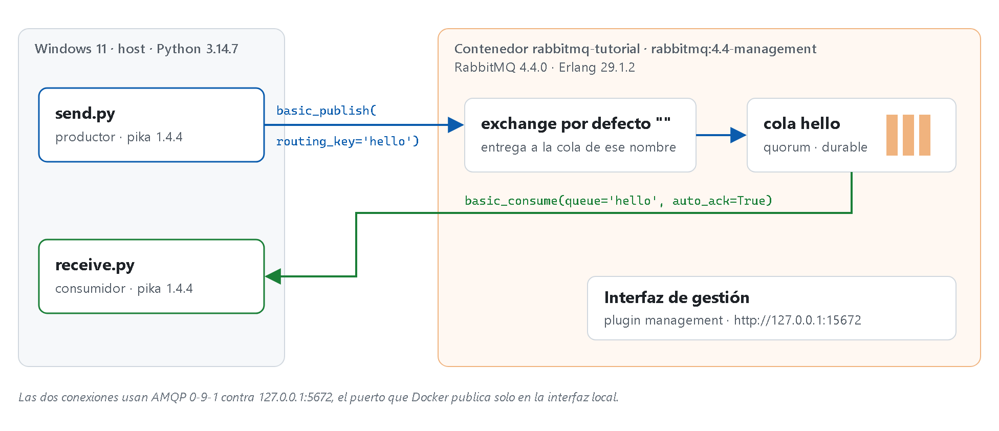
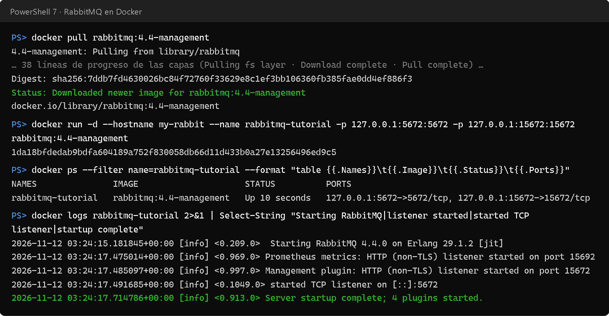
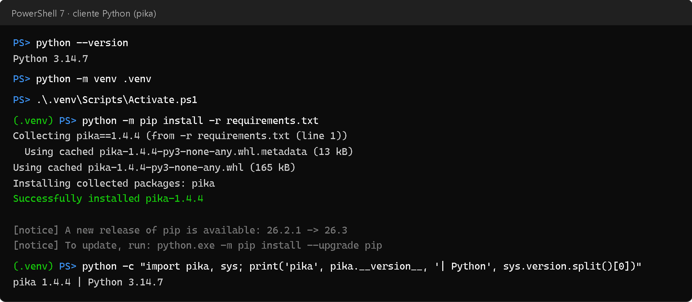
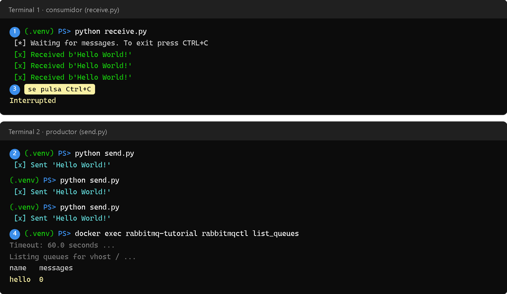
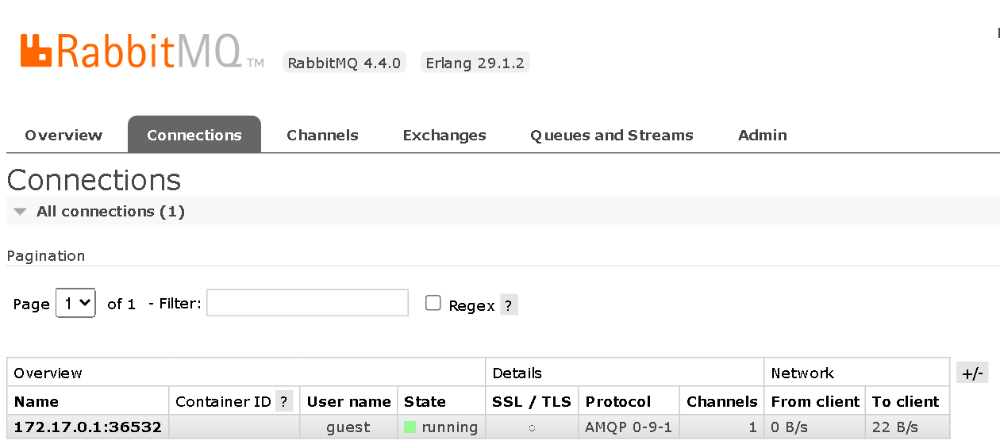
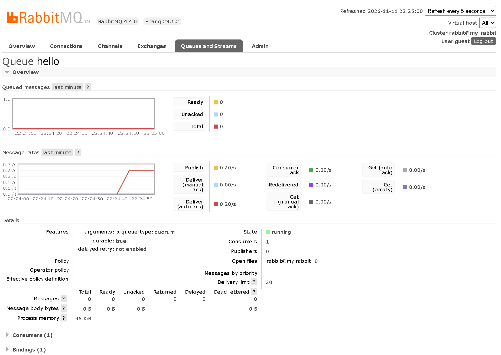
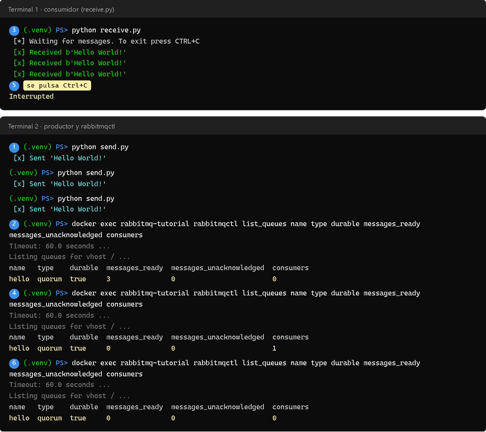
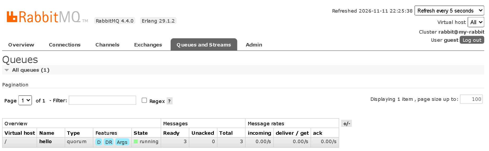
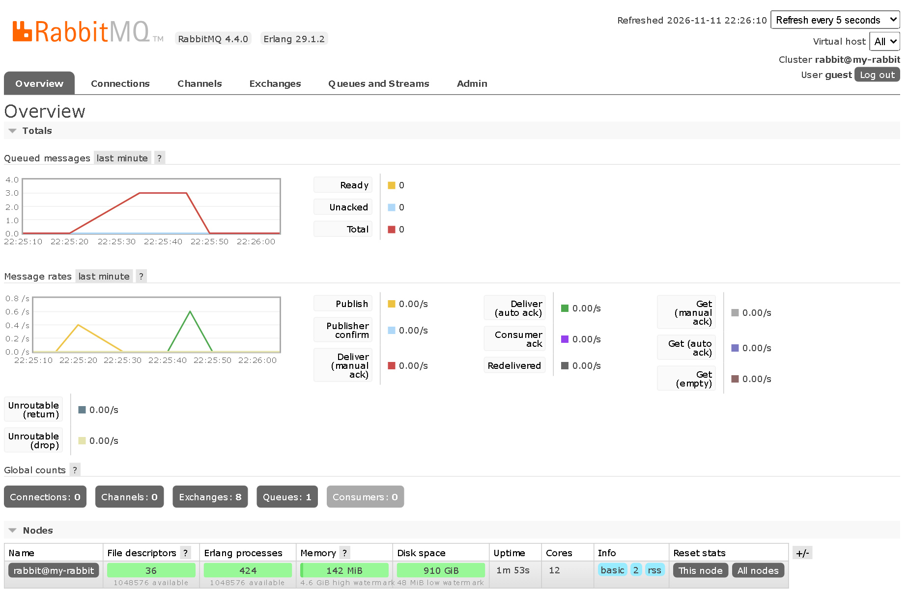

# Informe: productor y consumidor con RabbitMQ

Este informe recrea el primer tutorial oficial de RabbitMQ, «Hello World!» en Python, con un productor que envía un mensaje y un consumidor que lo recibe. RabbitMQ corre en Docker con la imagen oficial `rabbitmq` en lugar de la versión instalable. Todo se ejecutó el 11 de noviembre de 2026 en Windows 11, y las capturas son la evidencia de esa corrida.

## 1. Resumen

- **Broker.** RabbitMQ 4.4.0 en un contenedor de la imagen `rabbitmq:4.4-management`, con el puerto AMQP (5672) y el de la interfaz de gestión (15672) publicados solo en `127.0.0.1`.
- **Cliente.** Python 3.14.7 con `pika` 1.4.4, el cliente que recomienda el tutorial, instalado en un entorno virtual.
- **Código.** `send.py` y `receive.py` son los del tutorial, sin cambios, y están en la carpeta [`rabbitmq/`](../rabbitmq/) del repositorio.
- **Prueba 1.** Con el consumidor esperando, cada `send.py` llega al momento a `receive.py`.
- **Prueba 2.** Sin consumidor, la cola guarda los mensajes (3 listos). Al arrancar `receive.py` los recibe todos de golpe y la cola vuelve a 0.
- **Evidencia.** `rabbitmqctl` y la interfaz de gestión confirman cada paso: la conexión, la cola `hello` de tipo *quorum*, el consumidor y los mensajes.

## 2. Conceptos

RabbitMQ es un *broker* de mensajes: recibe mensajes de unos programas y los entrega a otros. El tutorial lo compara con una oficina de correos, donde el remitente deja la carta y el cartero la entrega. Los programas no se conocen entre sí: solo conocen al broker y el nombre de la cola.

| Término | Qué es en este ejemplo |
|---|---|
| Productor | `send.py`: abre una conexión, publica un mensaje y termina |
| Cola | `hello`: el buzón donde el broker guarda los mensajes hasta que alguien los consume |
| Consumidor | `receive.py`: se suscribe a la cola y espera mensajes hasta que se pulsa Ctrl+C |
| Exchange por defecto | El exchange de nombre vacío (`exchange=''`). Entrega el mensaje a la cola cuyo nombre coincide con la `routing_key` |
| `routing_key` | Con el exchange por defecto, es el nombre de la cola de destino: `'hello'` |
| `auto_ack=True` | El broker da el mensaje por entregado en cuanto lo envía al consumidor, sin esperar confirmación. El tutorial 2 lo cambia por confirmaciones manuales |
| Cola *quorum* | El tipo de cola que usa la versión actual del tutorial (`x-queue-type: quorum`). Es duradera y se replica con Raft; aquí hay un solo nodo |

En RabbitMQ un mensaje nunca va directo a una cola: siempre pasa por un exchange. El exchange por defecto permite ignorar ese paso por ahora, porque basta con nombrar la cola en la `routing_key`.

Los dos programas llaman a `queue_declare`. Declarar una cola es idempotente: la primera llamada la crea y las siguientes no hacen nada. Así no importa cuál de los dos arranque primero. Si el productor publicara en una cola que no existe, RabbitMQ descartaría el mensaje.



*Figura 1. Arquitectura del ejemplo. `send.py` publica en el exchange por defecto, que deja el mensaje en la cola `hello`; `receive.py` lo consume desde esa cola.*

## 3. RabbitMQ con la imagen de Docker

El enunciado permitía la imagen de Docker o la versión instalable. Se eligió la imagen oficial por tres razones:

- en Windows, la versión instalable exige instalar primero Erlang/OTP y después RabbitMQ como servicio;
- la imagen fija la versión exacta (RabbitMQ 4.4.0 con Erlang 29.1.2);
- se borra sin dejar rastro en el sistema.

El código de Python es el mismo en los dos casos, porque solo ve `localhost:5672`.

La variante `-management` incluye el plugin de la interfaz web. El contenedor se crea con un solo comando:

```powershell
docker run -d --hostname my-rabbit --name rabbitmq-tutorial -p 127.0.0.1:5672:5672 -p 127.0.0.1:15672:15672 rabbitmq:4.4-management
```

| Opción | Para qué |
|---|---|
| `-d` | Corre el contenedor en segundo plano |
| `--hostname my-rabbit` | RabbitMQ guarda sus datos según el nombre del nodo (`rabbit@my-rabbit`); un nombre fijo evita que cambie al recrear el contenedor |
| `--name rabbitmq-tutorial` | Nombre para referirse al contenedor en `docker logs`, `docker exec` y `docker stop` |
| `-p 127.0.0.1:5672:5672` | Publica el puerto AMQP solo en la interfaz local, así que nadie de la red puede conectarse |
| `-p 127.0.0.1:15672:15672` | Publica la interfaz de gestión, también solo en local |

La figura 2 muestra la descarga de la imagen, el arranque y el log del broker. «Server startup complete» indica que el broker ya acepta conexiones.



*Figura 2. Descarga de la imagen, creación del contenedor y log de arranque. Las 38 líneas de progreso de la descarga se resumen en una.*

**El usuario `guest`.** Por defecto, RabbitMQ solo acepta al usuario `guest` (contraseña `guest`) desde la propia máquina. Dentro de Docker, las conexiones del host llegan desde la puerta de enlace de la red del contenedor (`172.17.0.1`, como muestra la figura 6), no desde *loopback*. Por eso la imagen oficial trae en `/etc/rabbitmq/conf.d/10-defaults.conf` la línea `loopback_users.guest = false`. Con los puertos publicados solo en `127.0.0.1`, eso no abre el broker a la red.

## 4. El cliente de Python

El tutorial instala `pika` con `python -m pip install pika --upgrade`. Aquí se instala en un entorno virtual y con la versión fijada en [`requirements.txt`](../rabbitmq/requirements.txt) (`pika==1.4.4`), para no tocar el Python del sistema y poder repetir la instalación exacta.



*Figura 3. Entorno virtual en `rabbitmq/.venv` e instalación de `pika` 1.4.4 sobre Python 3.14.7.*

## 5. El código

Los dos archivos están en [`rabbitmq/`](../rabbitmq/) y son idénticos a los del tutorial.

### 5.1 Productor: `send.py`

```python
#!/usr/bin/env python
import pika

connection = pika.BlockingConnection(
    pika.ConnectionParameters(host='localhost'))
channel = connection.channel()

channel.queue_declare(queue='hello', durable=True, arguments={'x-queue-type': 'quorum'})

channel.basic_publish(exchange='', routing_key='hello', body='Hello World!')
print(" [x] Sent 'Hello World!'")
connection.close()
```

1. `BlockingConnection` abre una conexión TCP con el broker en `localhost:5672`, con el usuario `guest` por defecto, y `channel()` abre un canal dentro de ella. Casi toda la API de AMQP se usa a través del canal.
2. `queue_declare` crea la cola `hello` si no existe, duradera y de tipo *quorum*.
3. `basic_publish` envía el texto al exchange por defecto con `routing_key='hello'`.
4. `connection.close()` vacía los búferes de red y cierra la conexión, con lo que el mensaje queda en manos del broker.

### 5.2 Consumidor: `receive.py`

```python
#!/usr/bin/env python
import pika, sys, os

def main():
    connection = pika.BlockingConnection(pika.ConnectionParameters(host='localhost'))
    channel = connection.channel()

    channel.queue_declare(queue='hello', durable=True, arguments={'x-queue-type': 'quorum'})

    def callback(ch, method, properties, body):
        print(f" [x] Received {body}")

    channel.basic_consume(queue='hello', on_message_callback=callback, auto_ack=True)

    print(' [*] Waiting for messages. To exit press CTRL+C')
    channel.start_consuming()

if __name__ == '__main__':
    try:
        main()
    except KeyboardInterrupt:
        print('Interrupted')
        try:
            sys.exit(0)
        except SystemExit:
            os._exit(0)
```

1. Declara la misma cola, por si el consumidor arranca antes que el productor.
2. `basic_consume` registra `callback` para la cola `hello`. Pika llama a esa función con cada mensaje que entrega el broker.
3. `start_consuming()` entra en un bucle que espera mensajes indefinidamente.
4. Ctrl+C lanza `KeyboardInterrupt`; el programa imprime `Interrupted` y sale.

El tutorial muestra la salida como `[x] Received 'Hello World!'`, pero en Python 3 `body` llega como `bytes`, así que la salida real es `[x] Received b'Hello World!'`, con el prefijo `b`.

## 6. Pruebas y evidencia

Un script ejecutó toda la secuencia, desde la descarga de la imagen hasta el último `rabbitmqctl`, y guardó la salida real de cada comando:

- **Terminales.** Las figuras de terminal reproducen esa salida tal cual. El consumidor corrió en una consola virtual, así que el Ctrl+C que lo detiene es real y `Interrupted` lo imprimió el propio programa.
- **Interfaz de gestión.** Sus figuras son capturas de Chromium sin ventana, tomadas en los momentos indicados.
- **Pasos numerados.** En las figuras con dos terminales, los números azules marcan el orden en que ocurrió cada acción.

### 6.1 Prueba 1: el consumidor espera y el productor envía

El tutorial pide dos terminales: en una corre el consumidor, que se queda esperando, y en la otra el productor, que termina tras cada envío.



*Figura 4. Primera prueba. El consumidor (1) espera; cada `send.py` (2) aparece en la terminal 1 como `Received`. Después se pulsa Ctrl+C (3) y `rabbitmqctl list_queues` (4) confirma que la cola quedó vacía.*

Mientras el consumidor estaba conectado, la interfaz de gestión mostró su conexión y su suscripción:



*Figura 5. Pestaña Connections con la conexión de `receive.py`: usuario `guest`, protocolo AMQP 0-9-1 y un canal. Llega desde `172.17.0.1`, la puerta de enlace de Docker.*



*Figura 6. Detalle de la cola `hello`: `x-queue-type: quorum`, `durable: true` y 1 consumidor. Publish y Deliver (auto ack) marcan la misma tasa (0,20/s), porque cada mensaje publicado se entrega en el acto, y no queda ninguno en la cola.*

### 6.2 Prueba 2: la cola guarda los mensajes hasta que llega un consumidor

La segunda prueba invierte el orden y muestra lo que aporta la cola: el productor no necesita que el consumidor esté conectado.



*Figura 7. Segunda prueba. Sin consumidor, tres envíos (1) dejan 3 mensajes listos (2). Al arrancar `receive.py` (3), los recibe de inmediato; la cola queda en 0 con 1 consumidor (4) y, tras Ctrl+C (5), sin consumidores (6).*

Entre los pasos 2 y 3, la interfaz mostraba los tres mensajes esperando en la cola:



*Figura 8. Pestaña Queues entre los pasos 2 y 3: la cola `hello`, de tipo quorum, con 3 mensajes en Ready.*

Al terminar, el gráfico de mensajes encolados del Overview resume la prueba:



*Figura 9. Overview al final de la corrida. En «Queued messages», la línea sube a 3 con los envíos y cae a 0 cuando se conecta el consumidor. En «Message rates», el pico amarillo son las publicaciones y el verde, las entregas. Los contadores globales quedan en 0 conexiones y 0 consumidores.*

### 6.3 Resultados

| Prueba | Esperado | Obtenido |
|---|---|---|
| Arranque del broker | El log dice «Server startup complete» | Sí, con 4 plugins y los puertos 5672 y 15672 escuchando (figura 2) |
| Envío con el consumidor activo | Cada `Sent` produce un `Received` | 3 enviados, 3 recibidos (figura 4) |
| Cierre del consumidor | Ctrl+C imprime `Interrupted` | Sí (figuras 4 y 7) |
| Envío sin consumidor | Los mensajes esperan en la cola | `messages_ready` = 3 en `rabbitmqctl` y en la interfaz (figuras 7 y 8) |
| Conexión tardía del consumidor | Recibe lo acumulado y la cola se vacía | 3 recibidos al conectarse; `messages_ready` = 0 (figuras 7 y 9) |

## 7. Problemas encontrados

**El primer contenedor no arrancó.** El log terminaba con `Error when reading /var/lib/rabbitmq/.erlang.cookie: eacces`. La causa fue el propio script de espera: comprobaba si el broker estaba listo con `docker exec rabbitmq-tutorial rabbitmq-diagnostics -q check_port_connectivity`. `docker exec` entra como `root`, y la herramienta, que también es un programa Erlang, creó la cookie de Erlang como `root` con permisos `400` antes de que el servidor la creara. El servidor corre como el usuario `rabbitmq`, no pudo leerla y se detuvo.

Se confirmó repitiéndolo en un contenedor aparte, donde la cookie quedó como `root root`; en el contenedor sano pertenece a `rabbitmq rabbitmq`. La solución es esperar a que el log diga «Server startup complete» antes de usar `docker exec`, o ejecutarlo con `-u rabbitmq`.

**Las estadísticas tardan hasta 5 segundos.** En una corrida de prueba, un `rabbitmqctl list_queues` lanzado justo después de los envíos mostró 2 mensajes en lugar de 3. Las métricas de las colas se recogen cada 5 segundos (`collect_statistics_interval`), así que `rabbitmqctl` y la interfaz pueden mostrar el estado de hace unos segundos. La corrida final espera 6 segundos antes de cada consulta. El orden de las salidas del consumidor (`Received`) no depende de ese intervalo: son la prueba directa de la entrega.

## 8. Cómo reproducirlo

Desde la carpeta `rabbitmq/` del repositorio, en PowerShell:

```powershell
docker run -d --hostname my-rabbit --name rabbitmq-tutorial -p 127.0.0.1:5672:5672 -p 127.0.0.1:15672:15672 rabbitmq:4.4-management
python -m venv .venv
.\.venv\Scripts\Activate.ps1
python -m pip install -r requirements.txt
python receive.py
```

En una segunda terminal, con el entorno activado:

```powershell
python send.py
docker exec rabbitmq-tutorial rabbitmqctl list_queues
```

La interfaz de gestión queda en `http://127.0.0.1:15672` (usuario y contraseña `guest`). Para terminar, sin dejar nada instalado:

```powershell
docker stop rabbitmq-tutorial
docker rm -v rabbitmq-tutorial
```

## 9. Conclusión

El tutorial funcionó sin cambios en el código: bastó una imagen de Docker y una dependencia de Python. Las dos pruebas muestran la idea central de una cola de mensajes, que es separar al que envía del que recibe:

- con el consumidor conectado, la entrega es inmediata;
- sin él, el broker guarda los mensajes y los entrega cuando llega.

Los siguientes tutoriales parten de aquí: varios consumidores con confirmaciones manuales (Work Queues), exchanges `fanout`, `direct` y `topic`, y RPC.

## 10. Fuentes

- RabbitMQ. *Hello World! — Python* (tutorial 1): <https://www.rabbitmq.com/tutorials/tutorial-one-python>
- Docker Hub. Imagen oficial `rabbitmq`: <https://hub.docker.com/_/rabbitmq>
- RabbitMQ. *Authentication, Authorisation, Access Control* (usuarios *loopback*): <https://www.rabbitmq.com/docs/access-control>
- RabbitMQ. *Quorum Queues*: <https://www.rabbitmq.com/docs/quorum-queues>
- Pika: <https://pika.readthedocs.io/>
