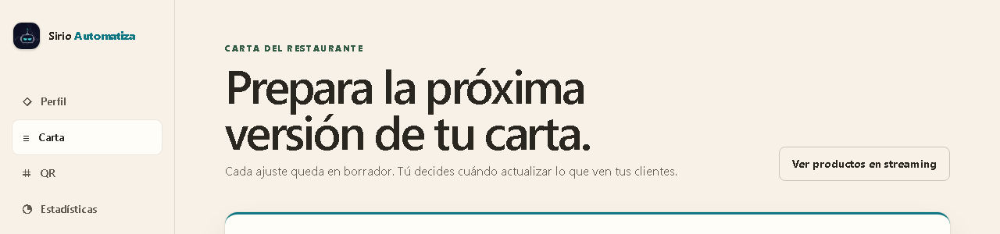
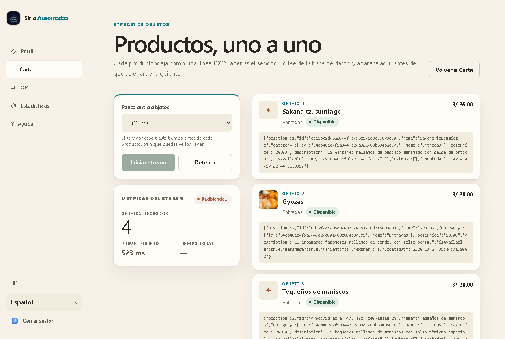
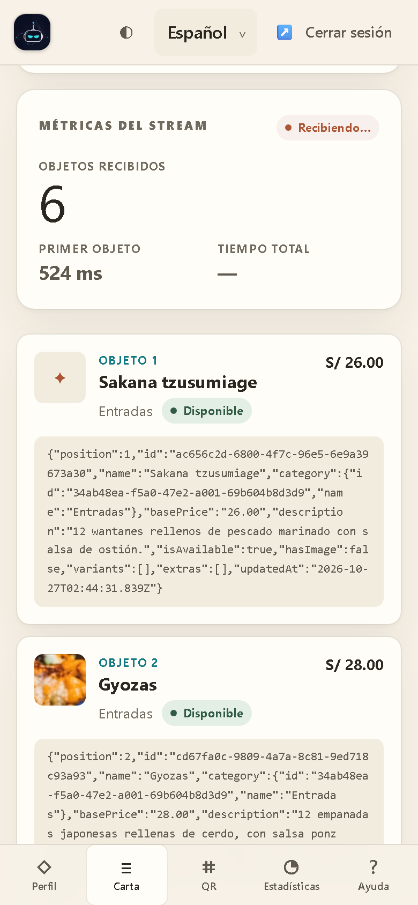
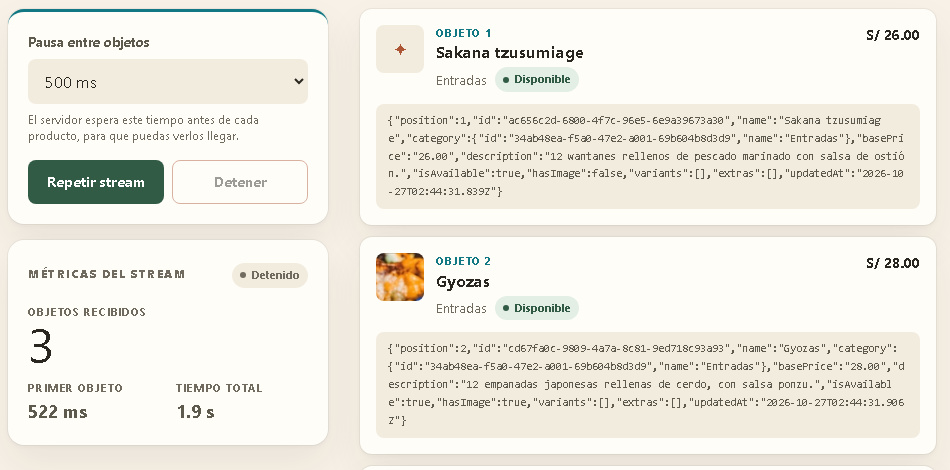
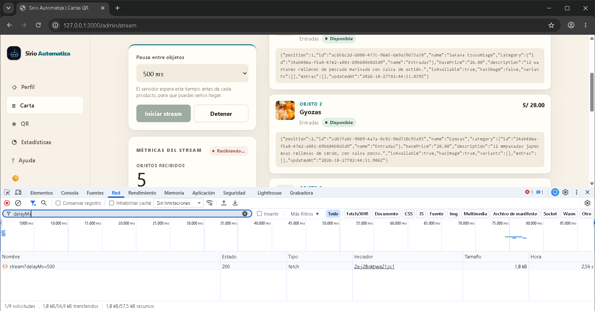
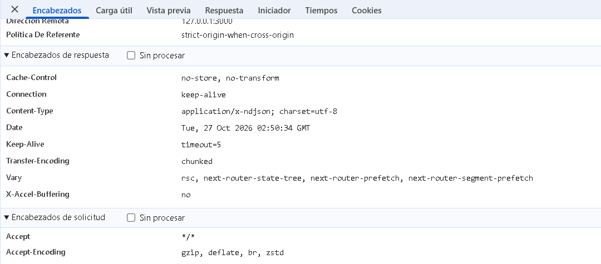
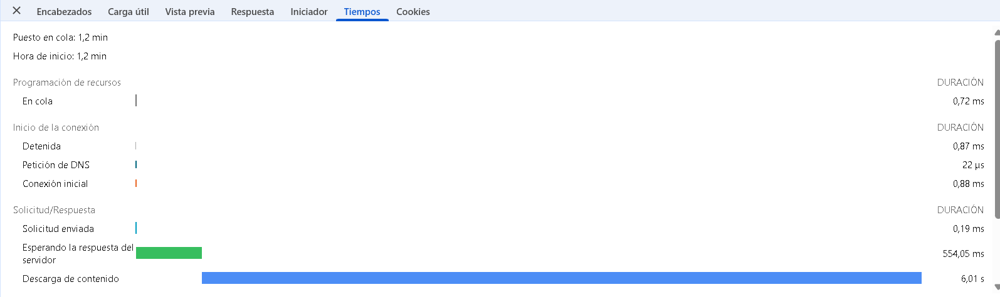
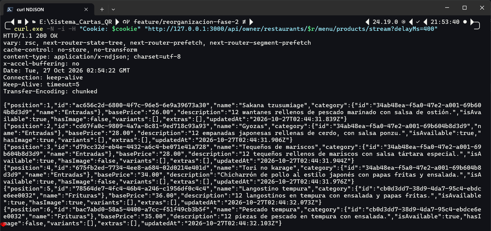
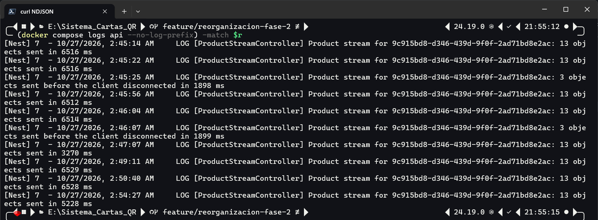

# Informe: stream de objetos con Node.js en el Sistema de Cartas QR

Este informe explica qué es un stream de objetos en Node.js, cómo se construye y cómo se aplicó en el proyecto con un ejemplo sencillo: el panel del dueño recibe los productos de su carta uno a uno, a medida que el servidor los lee de PostgreSQL. Las capturas son del sistema real, levantado con Docker Compose, el 27 de octubre de 2026.

## 1. Resumen

- La API (NestJS) expone `GET /api/owner/restaurants/:restaurantId/menu/products/stream`, que responde **NDJSON**: un producto por línea, enviado apenas se lee de la base de datos.
- Del lado del servidor, los productos recorren una cadena de streams en **modo objeto** unida con `pipeline`: un generador asíncrono lee lotes de 20 filas, una etapa opcional espacia los objetos y otra los convierte en líneas de texto.
- La página `/admin/stream`, enlazada desde Carta, lee esa respuesta con la API de streams del navegador y pinta cada producto en cuanto llega, junto con la línea NDJSON tal como viajó. Su botón **Detener** corta la descarga y la API deja de leer la base de datos.

## 2. Qué es un stream de objetos

### 2.1 Streams en Node.js

Un stream procesa datos por partes, sin tenerlos todos en memoria. Node.js define cuatro tipos: `Readable` (fuente), `Writable` (destino), `Duplex` (ambas cosas) y `Transform` (un `Duplex` que transforma lo que recibe).

Por defecto, un stream maneja bytes (`Buffer`) o texto. En **modo objeto** (`objectMode: true`) acepta cualquier valor de JavaScript excepto `null`, que está reservado para marcar el final. Así, cada `chunk` es un objeto completo (aquí, un producto) y no un trozo de bytes arbitrario.

El modo cambia también la unidad del búfer interno: `highWaterMark` cuenta **objetos** y no bytes. Su valor por defecto es 16 objetos. En un stream de bytes es 64 KiB, o 16 KiB en Windows. Es un umbral, no un límite estricto: cuando el búfer lo alcanza, el stream deja de pedir más datos a su fuente.

### 2.2 Contrapresión

La contrapresión (*backpressure*) es lo que impide que un productor rápido llene la memoria cuando el consumidor es lento. Cuando el búfer de un `Writable` supera su `highWaterMark`, `write()` devuelve `false` y la fuente debe esperar el evento `'drain'` antes de seguir.

La guía oficial de Node.js recomienda `pipeline()` en lugar de `.pipe()` por dos razones:

- **Errores:** `.pipe()` no destruye los demás streams cuando uno falla, y hay que cerrarlos a mano para no perder memoria. `pipeline()` propaga el error y destruye todas las etapas.
- **Cierre prematuro:** si el destino se cierra antes de terminar (por ejemplo, un cliente HTTP que se desconecta), `pipeline` termina con el error `ERR_STREAM_PREMATURE_CLOSE` y libera la fuente.

### 2.3 Cómo se crea uno

Hay tres piezas que bastan para casi todos los casos:

1. **`Readable.from(iterable)`** convierte un iterable o un generador asíncrono en un `Readable` que, por defecto, ya está en modo objeto. El generador solo avanza cuando el stream le pide el siguiente valor, así que la contrapresión llega hasta él.
2. **`Transform`** procesa un objeto a la vez. Con `objectMode` recibe y entrega objetos. Con `writableObjectMode` recibe objetos y entrega texto, que es lo que necesita una respuesta HTTP; la propia documentación de Node.js lo ilustra con un `Transform` que recibe números y emite texto hexadecimal.
3. **`pipeline`** (de `node:stream/promises`) conecta las etapas y devuelve una promesa que se resuelve al terminar o se rechaza con el primer error.

```js
import { Readable, Transform } from 'node:stream';
import { pipeline } from 'node:stream/promises';

async function* productos() {            // fuente: un objeto a la vez
  yield { nombre: 'Ceviche', precio: '35.00' };
  yield { nombre: 'Chicha morada', precio: '8.00' };
}
const aNdjson = new Transform({
  writableObjectMode: true,              // entran objetos, sale texto
  transform(objeto, _codificacion, listo) {
    listo(null, JSON.stringify(objeto) + '\n');
  },
});
await pipeline(Readable.from(productos()), aNdjson, process.stdout);
```

Para consumir un `Readable` también se puede usar `for await (const objeto of stream)`. Si el bucle termina con `break`, `return` o una excepción, el stream se destruye.

### 2.4 De objetos a la red: NDJSON

HTTP transporta bytes, así que en algún punto los objetos se serializan. NDJSON (*Newline Delimited JSON*) es el formato más simple que conserva la idea de «un objeto a la vez»: cada línea es un único texto JSON terminado en `\n`, todo en UTF-8, con el tipo de medio `application/x-ndjson`; el lector puede ignorar las líneas vacías.

| Formato | Cuándo puede usar el cliente el primer objeto | Observación |
|---|---|---|
| Arreglo JSON (`[...]`) | Al final, salvo que use un parser incremental | Un solo documento: `JSON.parse` necesita todo el texto |
| **NDJSON** | Apenas llega la primera línea completa | Funciona con `fetch` y con `curl`; cada línea se parsea por separado |
| Server-Sent Events | Apenas llega el primer evento | Formato `text/event-stream` con `EventSource`; pensado para eventos de texto |
| WebSocket | Apenas llega el primer mensaje | Bidireccional; el proyecto ya lo usa para el progreso de la digitalización ([informe](websocket.md)) |

Para el ejemplo, NDJSON es la opción natural: una única petición `GET` que pasa por el BFF y por Nginx como cualquier respuesta HTTP y que se puede probar con `curl`.

## 3. El ejemplo en Sirio

### 3.1 Qué ve el dueño

En **Carta**, el enlace «Ver productos en streaming» lleva a `/admin/stream`. Allí el dueño elige una pausa entre objetos (sin pausa, 100, 250 o 500 ms; sin ella, una carta pequeña llegaría de golpe) y pulsa **Iniciar stream**. Cada producto aparece con su posición, foto, sección, precio y disponibilidad, junto a la línea NDJSON tal como se recibió; las métricas cuentan los objetos recibidos, el tiempo hasta el primero y el total. **Detener** corta la descarga en cualquier momento.

El stream incluye todos los productos del borrador, también los no disponibles: son las filas reales de la tabla `Product`, en orden de sección y posición.

### 3.2 Dónde se agregó

| Capa | Archivo | Qué hace |
|---|---|---|
| API · dominio | [`menu-management.types.ts`](../backend/src/menu-management/domain/menu-management.types.ts#L48) | `PRODUCT_STREAM_LIMITS` (lotes de 20, pausa máxima de 1000 ms) y la forma de cada objeto, [`ProductStreamItem`](../backend/src/menu-management/domain/menu-management.types.ts#L79); el DTO [`ProductStreamQueryDto`](../backend/src/menu-management/presentation/menu-management.dto.ts#L110) valida la pausa |
| API · caso de uso | [`product-stream.use-cases.ts`](../backend/src/menu-management/application/use-cases/product-stream.use-cases.ts#L13) | Verifica la pertenencia ([L25](../backend/src/menu-management/application/use-cases/product-stream.use-cases.ts#L25)) y devuelve un generador asíncrono que lee lote a lote ([L40](../backend/src/menu-management/application/use-cases/product-stream.use-cases.ts#L40)) |
| API · repositorio | [`prisma-menu-management.repository.ts`](../backend/src/menu-management/infrastructure/prisma-menu-management.repository.ts#L372) | Secciones del restaurante y [lotes de productos](../backend/src/menu-management/infrastructure/prisma-menu-management.repository.ts#L393) con paginación por cursor, siempre a partir del último producto leído |
| API · streams | [`ndjson-stream.ts`](../backend/src/menu-management/presentation/ndjson-stream.ts#L61) | `PacingTransform` ([L10](../backend/src/menu-management/presentation/ndjson-stream.ts#L10)), `NdjsonEncoder` ([L35](../backend/src/menu-management/presentation/ndjson-stream.ts#L35)) y el `pipeline` hacia la respuesta ([L76](../backend/src/menu-management/presentation/ndjson-stream.ts#L76)) |
| API · controlador | [`product-stream.controller.ts`](../backend/src/menu-management/product-stream.controller.ts#L41) | Ruta protegida para el dueño; deja un registro con los objetos enviados y si el cliente se fue antes ([L59](../backend/src/menu-management/product-stream.controller.ts#L59)) |
| Web · BFF | [`stream/route.ts`](../frontend/src/app/api/owner/restaurants/[restaurantId]/menu/products/stream/route.ts#L3) | Reenvía la petición con `request.signal` ([L15](../frontend/src/app/api/owner/restaurants/[restaurantId]/menu/products/stream/route.ts#L15)) para que la cancelación llegue a la API |
| Web · proxy | [`api-server.ts`](../frontend/src/lib/api-server.ts#L163) | `proxyApiStream`: entrega el cuerpo tal como llega ([L173](../frontend/src/lib/api-server.ts#L173)), sin leerlo entero |
| Web · lector | [`ndjson.ts`](../frontend/src/lib/ndjson.ts#L15) | Generador que lee el cuerpo por trozos y entrega un objeto por línea |
| Web · pantalla | [`product-stream-viewer.tsx`](../frontend/src/app/admin/stream/product-stream-viewer.tsx#L113) | Inicia la descarga, pinta cada objeto ([L134](../frontend/src/app/admin/stream/product-stream-viewer.tsx#L134)) y la corta con **Detener** ([L151](../frontend/src/app/admin/stream/product-stream-viewer.tsx#L151)); el enlace vive en la cabecera de Carta ([`menu-digitizer.tsx`](../frontend/src/app/admin/menu/menu-digitizer.tsx#L238)) |

### 3.3 Recorrido de un producto

```text
PostgreSQL ── lotes de 20 filas, por cursor ──→ generador asíncrono (caso de uso)
   → Readable.from            modo objeto, búfer de 16 objetos
   → PacingTransform          modo objeto: espera la pausa elegida
   → NdjsonEncoder            objeto → JSON.stringify + "\n"
   → respuesta de NestJS      Transfer-Encoding: chunked
   → Route Handler de Next    proxyApiStream: reenvía el cuerpo sin acumularlo
   → Nginx                    X-Accel-Buffering: no
   → navegador                fetch → getReader → TextDecoder → líneas → React
```

**1. La fuente es un generador asíncrono.** El caso de uso verifica que el restaurante sea del dueño antes de enviar nada, así que un rechazo todavía es un error HTTP normal. Después devuelve un generador que entrega los productos de un lote de a uno y solo pide el siguiente lote cuando el consumidor tomó los anteriores:

```ts
do {
  batch = await this.repository.findProductBatch(restaurantId, category.id, after, this.batchSize);
  for (const row of batch) {
    position += 1;
    yield toStreamItem(row, category, position);
  }
  const last = batch.at(-1);
  if (last) after = { id: last.id, sortOrder: last.sortOrder };
} while (batch.length === this.batchSize);
```

Cada lote empieza justo después del último producto leído, por `(sortOrder, id)`, en lugar de saltar filas con `OFFSET`: cada consulta usa el índice `(restaurantId, categoryId, sortOrder)` y la memoria nunca guarda más de un lote.

**2. El `pipeline` une las etapas y escribe en la respuesta**, que el controlador maneja a mano (`@Res()`) porque NestJS esperaría un valor único:

```ts
response.setHeader('Content-Type', 'application/x-ndjson; charset=utf-8');
response.setHeader('Cache-Control', 'no-store, no-transform');
response.setHeader('X-Accel-Buffering', 'no');
response.flushHeaders();

const encoder = new NdjsonEncoder();
await pipeline(Readable.from(objects), new PacingTransform(delayMs), encoder, response);
```

**3. El navegador reconstruye las líneas.** Los trozos de la red no respetan los límites de línea: una línea, o incluso una «ñ» de dos bytes, puede llegar partida. Por eso el lector decodifica con `stream: true`, que guarda los bytes incompletos para la siguiente llamada, y retiene el último fragmento hasta que llegue su `\n`:

```ts
const { done, value } = await reader.read();
pending += done ? decoder.decode() : decoder.decode(value, { stream: true });
const lines = pending.split('\n');
pending = finished ? '' : (lines.pop() ?? '');
for (const line of lines) {
  if (line.trim() !== '') yield { line, value: JSON.parse(line) as T };
}
```

### 3.4 Cancelación de punta a punta

Pulsar **Detener** pone en marcha esta cadena:

1. La página llama a `AbortController.abort()` y se cancela el `fetch` del navegador.
2. Next.js detecta que el cliente se fue y aborta el `request.signal` del Route Handler, que lo había pasado a su propio `fetch` hacia la API.
3. La respuesta de NestJS se cierra antes de terminar. `pipeline` lo detecta como `ERR_STREAM_PREMATURE_CLOSE` y destruye todas las etapas.
4. Al destruirse, `Readable.from` llama a `return()` sobre el generador, y la API no consulta más lotes.

La API deja constancia en su registro, por ejemplo «3 objects sent before the client disconnected in 1898 ms» (figura 9).

### 3.5 Intermediarios que acumulan datos

Un stream solo se nota si ninguna capa intermedia junta los trozos antes de entregarlos. Hubo que revisar cuatro:

- **Compresión.** Gzip y Brotli acumulan datos antes de comprimir. `Cache-Control: no-transform` le indica a la capa de compresión de Next que no toque la respuesta. DevTools lo confirma: el navegador acepta `gzip, deflate, br, zstd` y aun así la respuesta llega sin `Content-Encoding` (figura 6).
- **Nginx.** Por defecto lee la respuesta del servidor en sus búferes antes de pasarla al cliente. La cabecera `X-Accel-Buffering: no` desactiva ese búfer para esta respuesta, y Nginx la consume sin reenviarla al navegador. Con 8 objetos y 200 ms de pausa, los trozos llegaron a 219, 420, 620… 1627 ms directo desde Next y a 225, 425, 631… 1632 ms a través de Nginx: el gateway no los junta.
- **Safari/WebKit.** Retiene el cuerpo hasta reunir unos 1024 bytes: en la prueba E2E con iPhone el primer producto aparece cuando ya llegaron unos cuatro, mientras que en Chrome y Android aparecen de uno en uno.
- **curl.** Hace falta `-N` para que no acumule la salida. Como cada objeto termina en salto de línea, la terminal muestra cada línea apenas llega (figura 8).

### 3.6 Seguridad y límites

- **Acceso.** La ruta exige sesión de dueño y pasa por `OwnerRestaurantGuard`: el stream de un restaurante ajeno responde `403`. `delayMs` debe ser un entero entre 0 y 1000; si no, `400`.
- **Errores a mitad del stream.** Las cabeceras ya salieron, así que la única señal posible es cortar la conexión: `pipeline` la corta, el controlador registra el error y el navegador muestra «El stream se cortó antes de terminar».
- **Memoria acotada.** Como mucho, un lote de 20 filas, un búfer de 16 objetos y lo que Node tenga pendiente de enviar por el socket.

## 4. Evidencia

**Figura 1.** El enlace en la cabecera de Carta lleva al ejemplo:



**Figura 2.** Con 500 ms de pausa, el primer objeto llegó a los 523 ms y van 4 de 13; cada uno trae su línea NDJSON:



**Figura 3.** En un teléfono de 390 px, 6 objetos y el stream abierto:



**Figura 4.** El dueño pulsó **Detener** después del tercer producto: el estado pasa a «Detenido», el tiempo total queda en «1.9 s» y no llega nada más:



**Figura 5.** Chrome DevTools, pestaña Red, a mitad del stream: la petición `stream?delayMs=500` sigue abierta con 1,8 kB recibidos a los 2,56 s, mientras la página ya muestra 5 objetos. Al terminar sumó 5,1 kB en 6,57 s:



**Figura 6.** Cabeceras de la respuesta: `application/x-ndjson`, `Transfer-Encoding: chunked`, `Cache-Control: no-store, no-transform` y `X-Accel-Buffering: no`. No hay `Content-Encoding`, aunque el navegador acepta compresión:



**Figura 7.** Pestaña Tiempos:

- La espera hasta el primer byte (554 ms) coincide con la primera pausa.
- La «descarga de contenido» dura 6,01 s: los 12 objetos restantes a 500 ms cada uno.

La guía de streaming de Next.js usa justo esta señal para confirmar que una respuesta llega por partes: un primer byte temprano y una descarga larga.



**Figura 8.** Windows Terminal, durante la respuesta. `curl.exe -N -i` contra el BFF muestra primero las cabeceras y después las 6 primeras líneas, cada una con un producto, mientras espera las siguientes (con 400 ms de pausa, los 13 llegaron en 5,35 s). La cookie de sesión va en una variable para no mostrar el token:



**Figura 9.** Registro de la API filtrado por este restaurante:

- los streams completos: «13 objects sent in 6516 ms» con 500 ms de pausa, 3270 ms con 250 ms y 5228 ms el de curl, con 400 ms;
- los cortados con **Detener**: «3 objects sent before the client disconnected in 1898 ms».



## 5. Pruebas

| Prueba | Qué verifica |
|---|---|
| [`product-stream.use-cases.spec.ts`](../backend/src/menu-management/application/use-cases/product-stream.use-cases.spec.ts) | Orden y numeración, lotes con el cursor correcto, que no lee por adelantado ni sigue leyendo si el consumidor se detiene, y rechazo de restaurantes ajenos |
| [`ndjson-stream.spec.ts`](../backend/src/menu-management/presentation/ndjson-stream.spec.ts) | Una línea por objeto, la pausa, las cabeceras, la fuente que se cierra cuando el cliente se va y el error de la fuente |
| [`product-stream.controller.spec.ts`](../backend/src/menu-management/product-stream.controller.spec.ts) | `404` antes de escribir nada y que un fallo con las cabeceras ya enviadas se registra en vez de propagarse |
| [`ndjson.test.ts`](../frontend/src/lib/ndjson.test.ts) | Líneas y una «ñ» partidas entre trozos, la última línea sin `\n` y la cancelación al dejar de leer |
| [`api-server.test.ts`](../frontend/src/lib/api-server.test.ts) y [`product-stream-viewer.test.tsx`](../frontend/src/app/admin/stream/product-stream-viewer.test.tsx) | El BFF entrega la primera línea antes de que termine la respuesta; la página pinta cada producto al llegar y resuelve **Detener**, el corte y la sesión vencida |
| [`product-stream.spec.ts`](../tests/e2e/product-stream.spec.ts#L139) (E2E) | Contra el stack real, en escritorio, Android e iPhone: llegada progresiva desde Carta y **Detener**; en escritorio, además, el NDJSON en orden ([L181](../tests/e2e/product-stream.spec.ts#L181)), `400` y `403` ([L203](../tests/e2e/product-stream.spec.ts#L203)) y la entrega progresiva por el BFF ([L221](../tests/e2e/product-stream.spec.ts#L221)) |

Al cerrar el ejemplo pasaban las 244 pruebas unitarias de la API, las 295 de la web y las 77 del paquete compartido; la suite E2E completa dio 150 pruebas en verde y 4 omitidas por diseño, y la spec del stream pasó en los tres perfiles.

## 6. Conclusión

Un stream de objetos en Node.js se arma con tres piezas: una fuente en modo objeto (aquí, un generador asíncrono envuelto en `Readable.from`), `Transform` para procesar o serializar cada objeto y `pipeline` para unirlas con contrapresión y con un cierre limpio ante errores o desconexiones. Para cruzar HTTP, NDJSON conserva la unidad «un objeto» con el formato más simple posible.

El ejemplo aplica esas piezas sobre datos reales del proyecto, respeta su arquitectura (caso de uso sin dependencias de NestJS, BFF de Next.js y gateway Nginx) y demuestra con capturas lo que el streaming promete: el primer producto se muestra en medio segundo aunque la carta completa tarde seis, el servidor nunca carga más de un lote y, si el usuario se va, la base de datos deja de trabajar.

## 7. Fuentes

- Node.js, documentación de [Stream](https://nodejs.org/api/stream.html) (modo objeto, `highWaterMark`, `Readable.from`, `pipeline`) y guía [Backpressuring in Streams](https://nodejs.org/en/learn/modules/backpressuring-in-streams).
- [Especificación de NDJSON](https://github.com/ndjson/ndjson-spec).
- MDN, [Using readable streams](https://developer.mozilla.org/en-US/docs/Web/API/Streams_API/Using_readable_streams) y [`TextDecoder.decode()`](https://developer.mozilla.org/en-US/docs/Web/API/TextDecoder/decode).
- Nginx, directiva [`proxy_buffering`](https://nginx.org/en/docs/http/ngx_http_proxy_module.html#proxy_buffering) y cabecera `X-Accel-Buffering`.
- Next.js, guía de [Streaming](https://nextjs.org/docs/app/guides/streaming): búferes intermedios, Safari y cómo verificar el streaming.
- WebKit, [bug 252413](https://bugs.webkit.org/show_bug.cgi?id=252413), sobre el búfer de 1024 bytes.
